<div align="center">

**[English](README.md) | Bahasa Indonesia**

# AoKira

### Digital Twin Workcell Robotik Industri

**Design. Simulate. Optimize. Operate.**

Simulasi manufaktur 3D interaktif, perencanaan gerak robot, dan optimasi produksi: semuanya berjalan di dalam browser.

[](https://github.com/Orls967/AoKiraDeck/actions/workflows/ci-deploy.yml)
[](https://orls967.github.io/AoKiraDeck/)


**[▶ Buka demo langsung](https://orls967.github.io/AoKiraDeck/)**

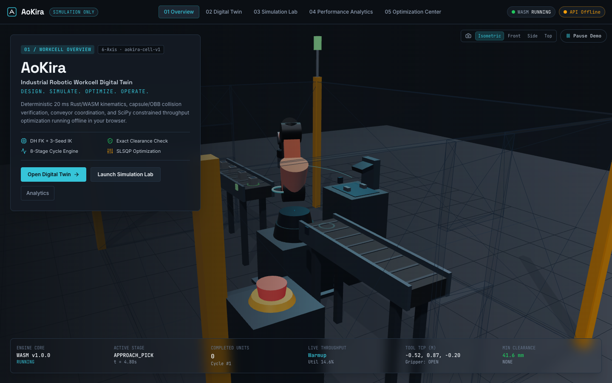

</div>

> [!IMPORTANT]
> **Hanya simulasi.** AoKira adalah demonstrator rekayasa sintetis yang deterministik. Ini **bukan** firmware kontrol robot, middleware PLC/ROS 2, sistem keselamatan tersertifikasi (ISO 10218 / ISO/TS 15066), maupun alat ukur listrik yang terkalibrasi. Setiap angka energi diberi label *"Synthetic engineering estimate only; not real electrical metering."*

---

## Daftar isi

- [Apa itu AoKira?](#apa-itu-aokira)
- [Demo langsung & mode menjalankan](#demo-langsung--mode-menjalankan)
- [Tur fitur (screenshot)](#tur-fitur)
  - [01 · Overview](#01--overview)
  - [02 · Digital Twin](#02--digital-twin)
  - [03 · Simulation Lab](#03--simulation-lab)
  - [04 · Performance Analytics](#04--performance-analytics)
  - [05 · Optimization Center](#05--optimization-center)
  - [Tampilan mobile](#tampilan-mobile)
  - [REST API (Swagger)](#rest-api-swagger)
- [Preset skenario](#preset-skenario)
- [Model energi & optimizer](#model-energi--optimizer)
- [Cara kerjanya](#cara-kerjanya)
- [Tech stack](#tech-stack)
- [Struktur repositori](#struktur-repositori)
- [Memulai](#memulai)
- [Pengujian & CI/CD](#pengujian--cicd)
- [Performa terukur](#performa-terukur)
- [Indeks dokumentasi](#indeks-dokumentasi)
- [Keterbatasan yang diketahui](#keterbatasan-yang-diketahui)

> Nama halaman, tombol, dan label di aplikasi memakai bahasa Inggris, sama seperti tampilannya di layar. Karena itu istilah tersebut sengaja tidak diterjemahkan di dokumen ini.

---

## Apa itu AoKira?

Mengevaluasi sel pick-and-place otomatis biasanya berarti memakai suite pemrograman offline yang mahal, atau serangkaian alat terpisah di mana kinematika, estimasi waktu siklus, pemeriksaan tabrakan, dan optimasi throughput masing-masing berada di spreadsheet atau viewer yang berbeda. Sebaliknya, demo web 3D yang ringan jarang punya kinematika sungguhan, validasi tabrakan, atau log event yang dapat ditelusuri.

AoKira menyatukan semuanya di sekitar **satu inti simulasi deterministik** untuk satu workcell virtual: robot articulated 6 sumbu generik dengan gripper dua jari, konveyor sabuk input dan output, stasiun pemrosesan, pagar pengaman, sensor, dan konsol E-stop.

- **Setiap gerakan dihitung.** Forward kinematics Standard-DH, inverse kinematics damped-least-squares dengan 3 seed, trajektori sendi quintic, dan pemeriksaan tabrakan capsule/OBB dengan ambang near-miss 25 mm. Semuanya ditulis dalam **Rust, dikompilasi ke WebAssembly**, dan berjalan pada jam tetap 20 ms di dalam Web Worker.
- **Setiap KPI berasal dari event.** Throughput, waktu siklus, utilisasi, waktu idle, downtime, tabrakan, dan energi sintetis diturunkan dari aliran event engine. Tidak ada yang di-mock.
- **Optimasi what-if.** Layanan **Python/FastAPI** yang stateless memeriksa KPI, menemukan bottleneck, memprakirakan shift 8 jam, membandingkan skenario, dan menjalankan optimasi berkendala **SciPy SLSQP**. Hasilnya bisa dimuat kembali ke simulator dengan satu klik.
- **Berjalan offline.** Twin 3D dan simulasi produksi penuh tetap berjalan di browser meskipun backend Python tidak dapat dijangkau.

**Dibuat untuk:** insinyur otomasi yang memeriksa jangkauan, clearance, dan waktu siklus; mahasiswa robotika yang mempelajari FK/IK, perencanaan trajektori, dan twin berbasis event; serta analis operasi yang membandingkan skenario what-if.

---

## Demo langsung & mode menjalankan

| Mode | Yang berjalan | Yang Anda dapatkan |
|---|---|---|
| **[GitHub Pages](https://orls967.github.io/AoKiraDeck/)** (statis) | UI React + engine Rust/WASM di browser Anda | Overview, Digital Twin, Simulation Lab, KPI dan grafik Analytics yang diturunkan dari event. Status pill menampilkan `API Offline`, dan panel khusus Python menampilkan status *Backend Unavailable* yang rapi. |
| **Full stack lokal** | Yang di atas + layanan FastAPI di `:8000` | Semuanya, termasuk pengayaan bottleneck/forecast/energi dari Python, perbandingan skenario, dan optimasi SLSQP. |

> Screenshot bertanda **(live)** diambil dari situs GitHub Pages yang sudah di-deploy. Screenshot bertanda **(full stack)** diambil dari build lokal yang terhubung ke layanan FastAPI. Semuanya berasal dari [`apps/web/screenshots/capture.spec.ts`](apps/web/screenshots/capture.spec.ts) (lihat [Membuat ulang screenshot](#membuat-ulang-screenshot)).

---

## Tur fitur

Aplikasi punya lima halaman yang bernomor di bilah navigasi atas. Di sisi kanan bilah, dua status pill menunjukkan kondisi engine WASM (`BOOTING` / `READY` / `RUNNING` / `PAUSED` / `COMPLETED` / `FAULTED`) dan koneksi API (`API Online` / `API Offline`).

### 01 · Overview

Halaman pembuka. Tampilan 3D sinematik dari workcell menjalankan demo pick-and-place langsung di atas engine WASM sungguhan, dengan kartu peluncuran dan strip telemetri di bagian bawah.

| Kontrol | Pilihan |
|---|---|
| Preset kamera | `Isometric` · `Front` · `Side` · `Top` (kamera mengorbit pelan saat tidak digunakan) |
| Transport demo | `Pause Demo` / `Resume Demo` |
| Pintasan | `Open Digital Twin` · `Launch Simulation Lab` · `Analytics` |

<table>
<tr>
<td width="50%">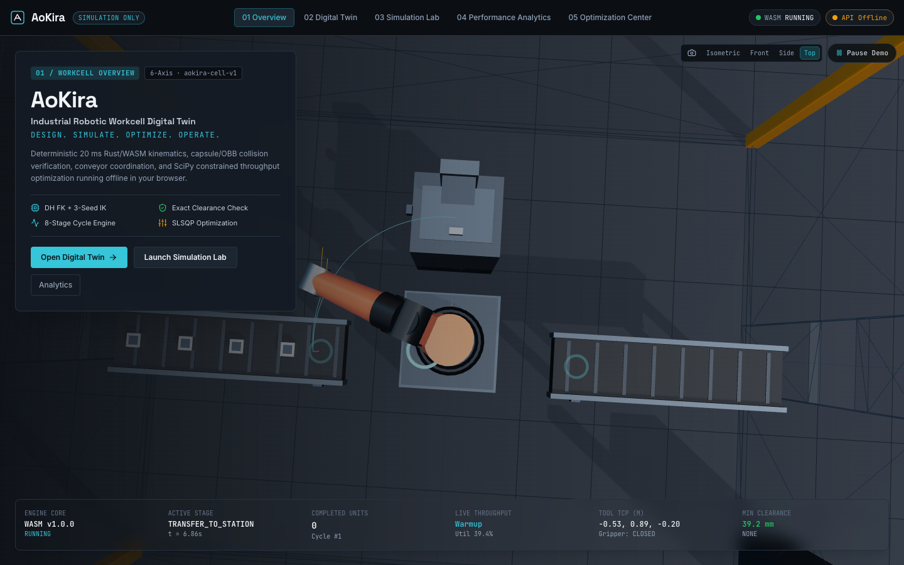<br><sub>Preset kamera <b>Top</b> (live)</sub></td>
<td width="50%">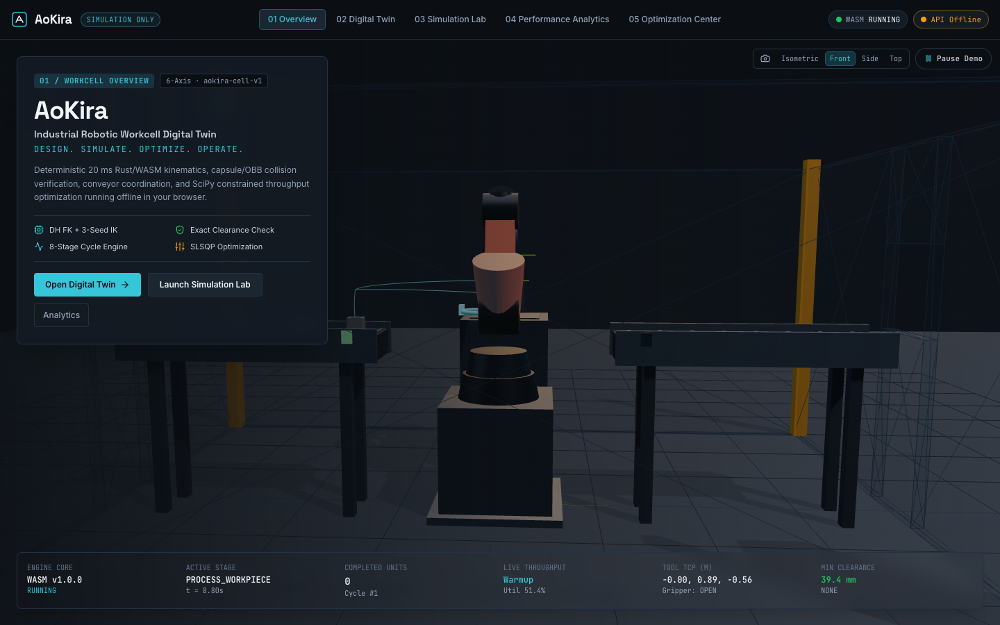<br><sub>Preset kamera <b>Front</b> (live)</sub></td>
</tr>
</table>

Strip telemetri diperbarui di setiap tick engine: versi engine, stage aktif dan waktu simulasi, unit yang selesai, throughput dan utilisasi langsung, posisi TCP tool dan status gripper, serta clearance tabrakan minimum.

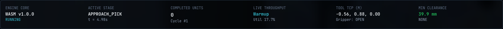

---

### 02 · Digital Twin

Inspektor bergaya CAD untuk seluruh workcell. Ada tiga panel: **Workcell Tree** di kiri, **viewport 3D** di tengah, dan **inspektor komponen, sendi, dan IK** di kanan.

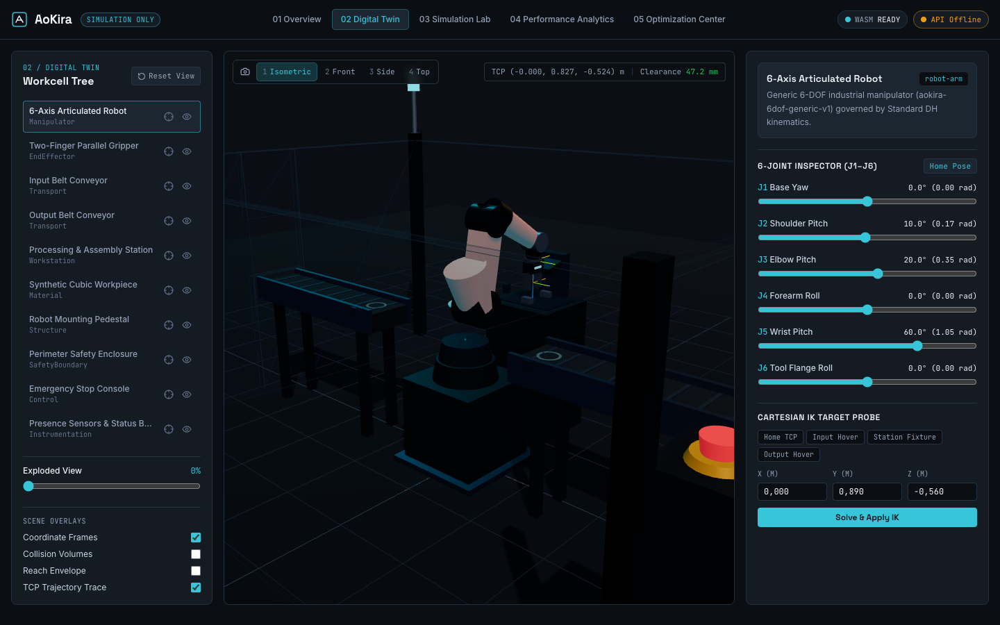
<sub>Tampilan default: robot terpilih, pose home, frame koordinat dan jejak TCP aktif (live)</sub>

**Preset kamera.** Gunakan `1 Isometric` · `2 Front` · `3 Side` · `4 Top`, yang juga tersedia sebagai pintasan keyboard `1`–`4`. Orbit, pan, dan zoom dengan mouse.

<table>
<tr>
<td width="25%">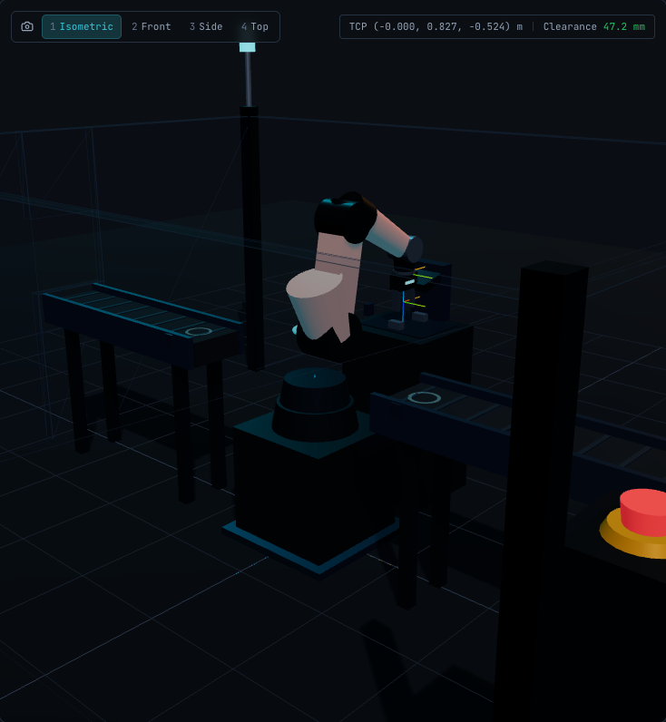<br><sub>1 · Isometric</sub></td>
<td width="25%">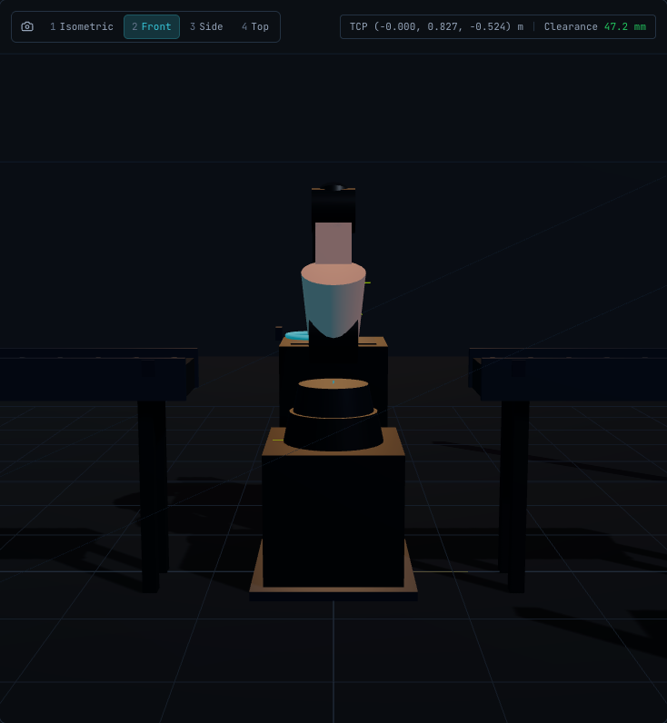<br><sub>2 · Front</sub></td>
<td width="25%">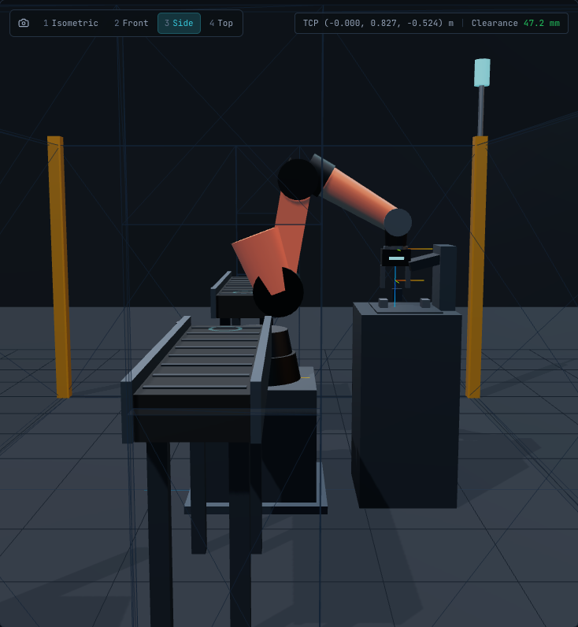<br><sub>3 · Side</sub></td>
<td width="25%">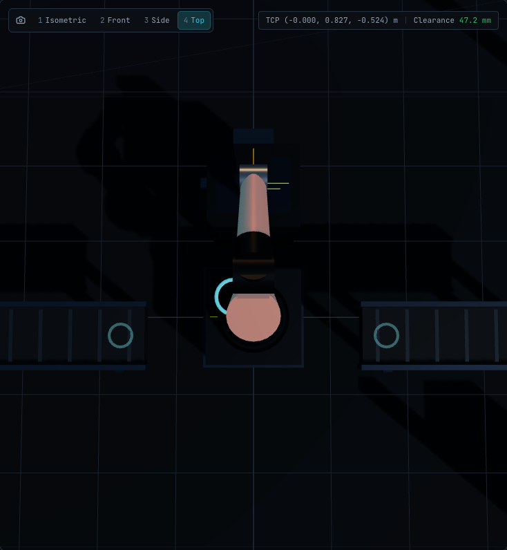<br><sub>4 · Top</sub></td>
</tr>
</table>

**Workcell Tree.** Tree ini menampilkan 10 komponen: 6-Axis Articulated Robot, Two-Finger Parallel Gripper, Input / Output Belt Conveyor, Processing & Assembly Station, Synthetic Cubic Workpiece, Robot Mounting Pedestal, Perimeter Safety Enclosure, Emergency Stop Console, serta Presence Sensors & Status Beacon. Klik sebuah komponen untuk memilihnya, gunakan ⌖ untuk **mengisolasinya**, atau 👁 untuk **menampilkan atau menyembunyikannya**. `Reset View` mengembalikan semuanya.

<table>
<tr>
<td width="50%">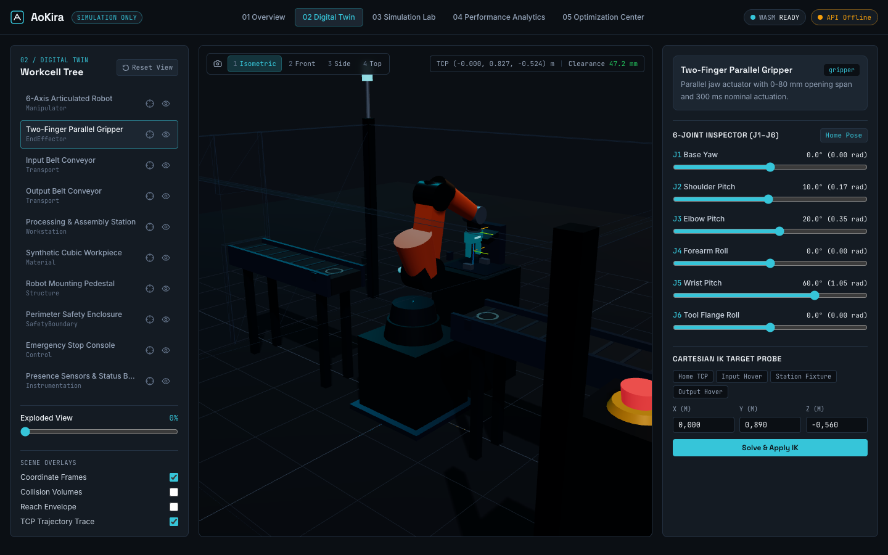<br><sub>Memilih <b>gripper</b> menyorotnya dan menampilkan kartu spesifikasinya (live)</sub></td>
<td width="50%">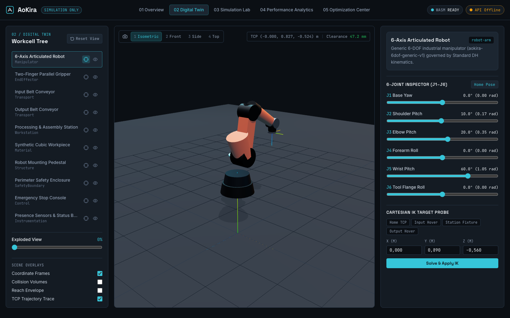<br><sub>Mode <b>Isolate</b> hanya menampilkan robot (live)</sub></td>
</tr>
</table>

**Overlay scene dan exploded view.** Toggle overlay: `Coordinate Frames` · `Collision Volumes` · `Reach Envelope` · `TCP Trajectory Trace`. Slider `Exploded View` (0–100 %) merenggangkan rakitan.

<table>
<tr>
<td width="50%">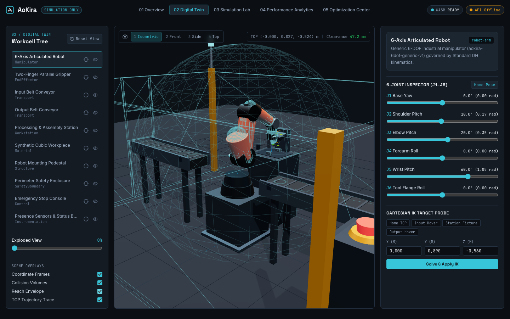<br><sub><b>Collision Volumes</b> + <b>Reach Envelope</b> aktif (live)</sub></td>
<td width="50%">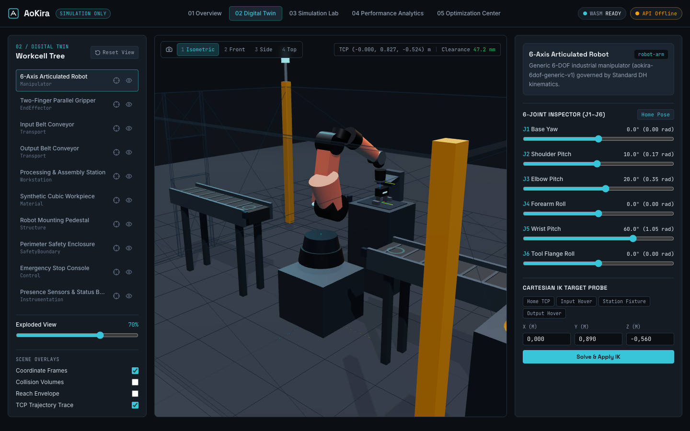<br><sub><b>Exploded View</b> pada 70 % (live)</sub></td>
</tr>
</table>

**6-Joint Inspector (FK).** Gerakkan (jog) `J1 Base Yaw`, `J2 Shoulder Pitch`, `J3 Elbow Pitch`, `J4 Forearm Roll`, `J5 Wrist Pitch`, dan `J6 Tool Flange Roll` di dalam batas sendinya. Pembacaan berubah menjadi amber ketika sebuah sendi berada di batasnya. `Home Pose` mengatur ulang semua sendi.

**Cartesian IK Target Probe.** Ketik target `x / y / z` dalam meter, atau pilih preset cepat (`Home TCP`, `Input Hover`, `Station Fixture`, `Output Hover`), lalu tekan `Solve & Apply IK`. Target yang tidak dapat dijangkau robot mengembalikan error terstruktur `UNREACHABLE_TARGET`, dan robot yang sedang berjalan tidak digerakkan.

<table>
<tr>
<td width="33%">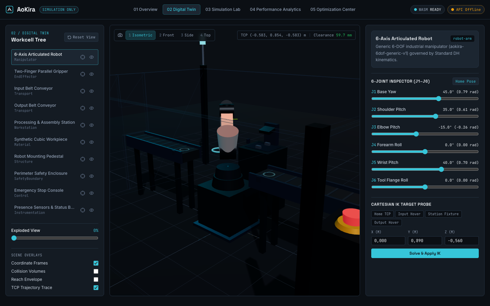<br><sub><b>Joint jog</b> manual J1/J2/J3/J5 (live)</sub></td>
<td width="33%">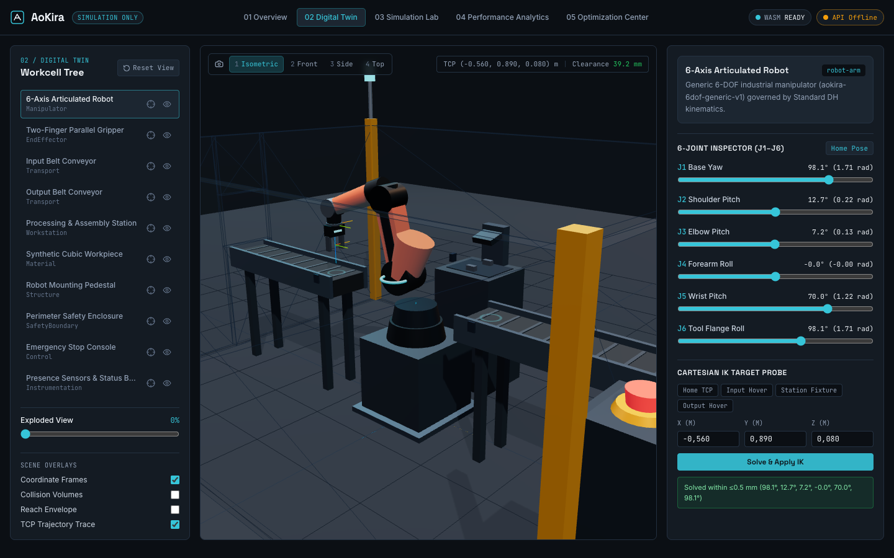<br><sub>IK terpecahkan untuk <b>Input Hover</b> (live)</sub></td>
<td width="33%">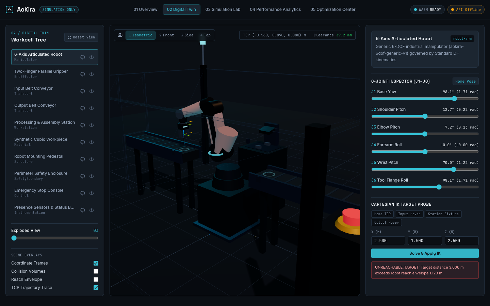<br><sub>Target di luar envelope mengembalikan <b>UNREACHABLE_TARGET</b> (live)</sub></td>
</tr>
</table>

---

### 03 · Simulation Lab

Dek kontrol produksi. Engine Rust/WASM menjalankan state machine pick-and-place 8 stage dengan langkah tetap 20 ms. Kecepatan playback hanya mengubah jumlah langkah tetap yang berjalan per frame, sehingga hasilnya tetap deterministik pada kecepatan berapa pun.

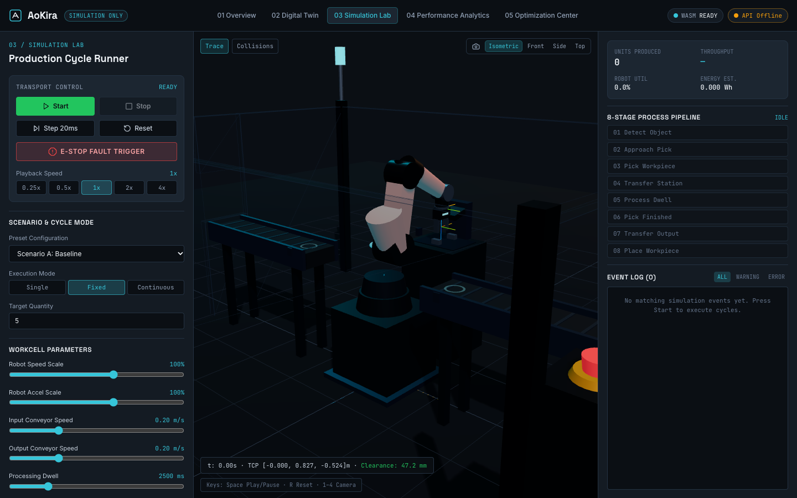
<sub>Status siap: dek transport, skenario dan mode siklus, parameter workcell, viewport 3D, tile KPI, pipeline, dan log event (live)</sub>

| Grup | Pilihan |
|---|---|
| **Transport control** | `Start` · `Pause` / `Resume` · `Stop` · `Step 20ms` · `Reset` · `E-Stop Fault Trigger` |
| **Playback speed** | `0.25x` · `0.5x` · `1x` · `2x` · `4x` |
| **Preset configuration** | Scenario A: Baseline · B: Faster Robot Motion · C: Optimized Trajectory · D: Adjusted Conveyor Speed (ditambah `*-optimized` setelah dimuat dari Optimization Center) |
| **Execution mode** | `Single` (satu siklus) · `Fixed` (jumlah target 1–100) · `Continuous` |
| **Workcell parameters** | Skala kecepatan dan akselerasi robot, kecepatan konveyor input/output, dwell proses, massa workpiece (terkunci saat berjalan: *Stop/Reset to edit*) |
| **Viewport overlays** | `Trace` · `Collisions` · kamera `Isometric / Front / Side / Top` |
| **Event log filter** | `ALL` · `WARNING` · `ERROR` |
| **Keyboard** | `Space` play/pause · `R` reset · `1`–`4` kamera |

**Pipeline 8 stage** menyorot stage aktif secara langsung: `01 Detect Object → 02 Approach Pick → 03 Pick Workpiece → 04 Transfer Station → 05 Process Dwell → 06 Pick Finished → 07 Transfer Output → 08 Place Workpiece`.

<table>
<tr>
<td width="50%">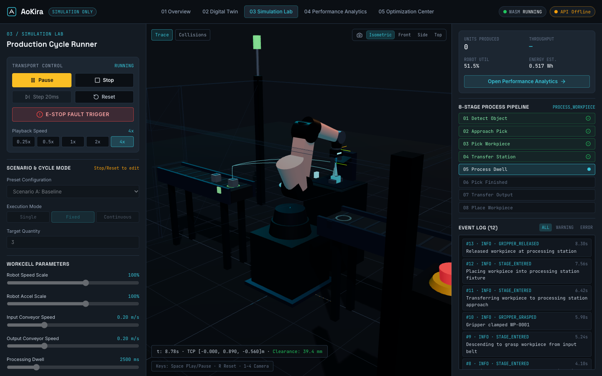<br><sub><b>Running</b> pada 4x: robot membawa billet ke stasiun (live)</sub></td>
<td width="50%">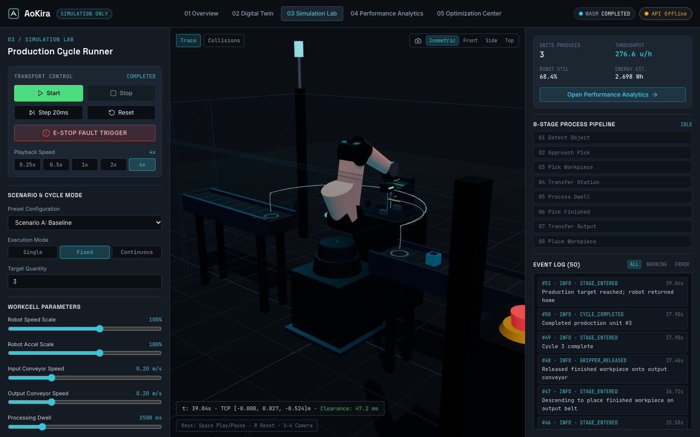<br><sub>Run <b>Fixed</b> 3 siklus <b>COMPLETED</b> (live)</sub></td>
</tr>
<tr>
<td width="50%">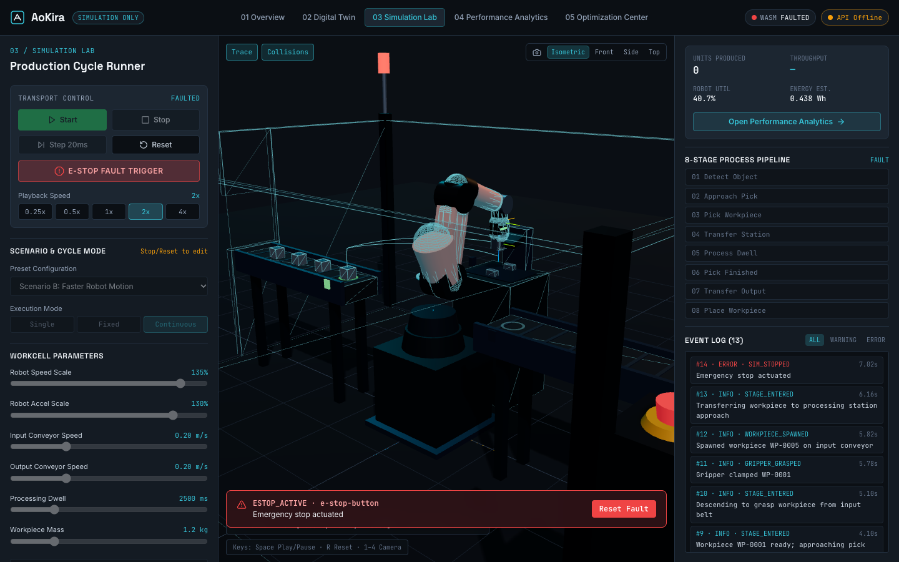<br><sub>Scenario B, <b>Continuous</b>, overlay <b>Collisions</b>, lalu <b>E-Stop</b>: banner fault dengan <code>Reset Fault</code> (live)</sub></td>
<td width="50%">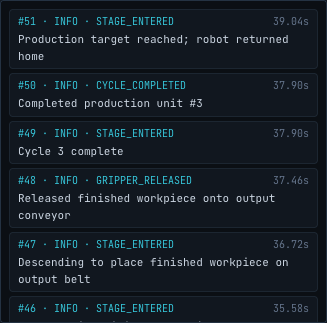<br><sub><b>Log event</b> berurutan dengan kode warna (live)</sub></td>
</tr>
</table>

---

### 04 · Performance Analytics

Semua KPI dihitung ulang dari aliran event engine. Ketika API dapat dijangkau, `Analyze with Python Backend` menambahkan diagnosis bottleneck, prakiraan shift 8 jam, rincian energi sintetis, dan pemeriksaan konsistensi client/server.

| Status | Screenshot |
|---|---|
| **Empty**: belum ada siklus, dengan tautan ke Simulation Lab | 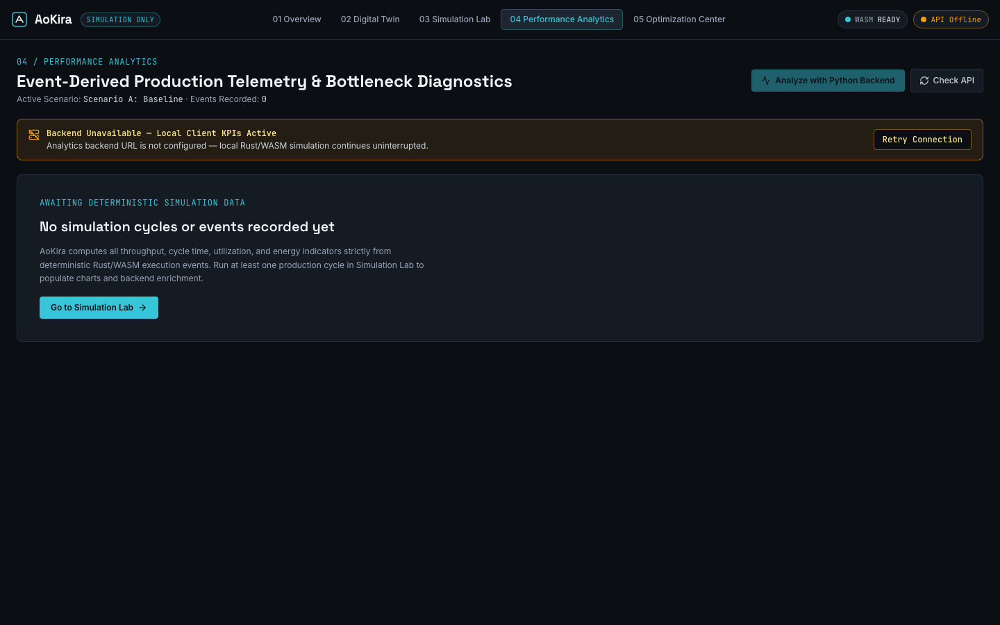 |
| **Offline** (GitHub Pages): 10 KPI lokal + 3 grafik, banner amber *Backend Unavailable* dengan `Retry Connection` (live) | 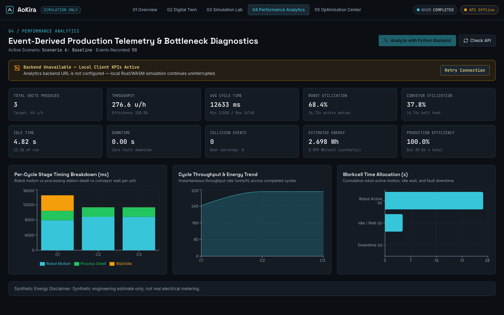 |
| **Online** (full stack): API Online | 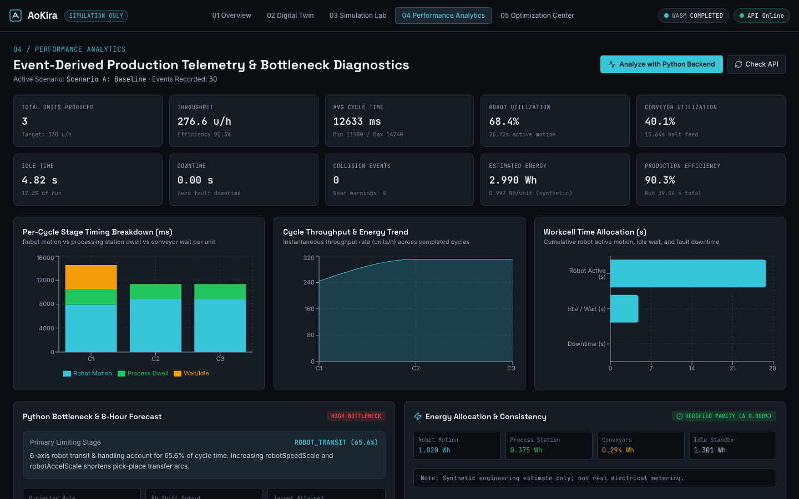 |

KPI: total unit, throughput (u/h), waktu siklus rata-rata/min/maks, utilisasi robot dan konveyor, waktu idle, downtime, event tabrakan dan peringatan near-miss, energi estimasi (Wh dan Wh/unit), serta efisiensi produksi.
Grafik: rincian waktu stage per siklus, throughput siklus dan tren energi, serta alokasi waktu workcell.

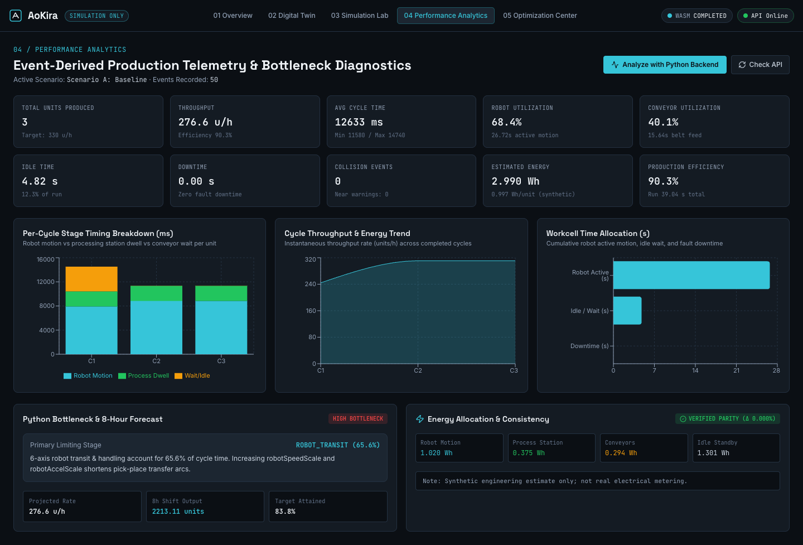
<sub>Halaman penuh setelah run Scenario A 3 siklus dengan pengayaan Python (full stack)</sub>

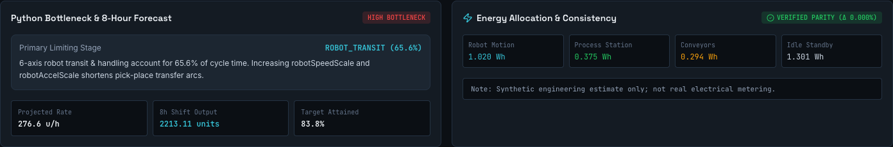
<sub>Pengayaan Python: stage pembatas utama, laju proyeksi, output shift 8 jam, alokasi energi, dan <code>VERIFIED PARITY</code> antara KPI browser dan server (full stack)</sub>

---

### 05 · Optimization Center

Bandingkan skenario dan cari parameter workcell yang lebih baik dengan SciPy SLSQP di bawah kendala nol tabrakan. Tiga objektif menghasilkan rekomendasi yang **benar-benar berbeda**, karena model energi menyertakan rugi daya resistif (I²R) pada penggerak yang tumbuh dengan kuadrat akselerasi. Gerakan yang lebih cepat memangkas waktu siklus tetapi menambah energi per bagian.

| Kontrol | Pilihan |
|---|---|
| **Base scenario** | Scenario A–D |
| **Objective function** | `Min Cycle` (siklus tercepat) · `Min Energy` (Wh per bagian paling sedikit: akselerasi lebih lembut) · `Balanced` (kompromi antara dua ekstrem, berbobot 45 % waktu / 35 % energi di atas rentang trade-off yang sebenarnya) |
| **Search bounds** | min/maks untuk skala kecepatan robot, skala akselerasi robot, belt input, belt output, dwell proses |
| **Optimize process dwell** | Mati secara default: dwell tetap pada nilai skenario dasar, karena ditentukan oleh proses (curing, machining), bukan oleh robot. Nyalakan agar optimizer ikut menyetelnya. |
| **Constraints** | min throughput (unit/jam), maks energi per unit (Wh) opsional. Nol tabrakan selalu ditegakkan: interlock belt pada engine menjaga setiap sudut rentang parameter yang diizinkan bebas tabrakan (`RUST-PROD-07`). |
| **Actions** | `Compare Scenarios (A–D)` · `Run Optimization` · `Compare Objectives` (menjalankan ketiganya) · `Load Base Preset Locally` · `Load` per baris · `Load into Simulation Lab` |

<table>
<tr>
<td width="50%">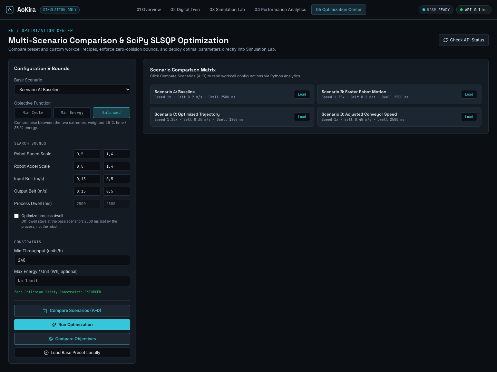<br><sub>Konfigurasi dan batas, kartu preset (full stack)</sub></td>
<td width="50%">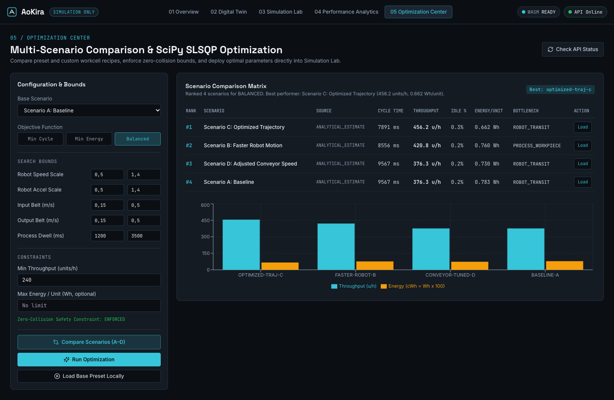<br><sub><b>Compare Scenarios</b>: matriks peringkat + grafik throughput/energi (full stack)</sub></td>
</tr>
</table>

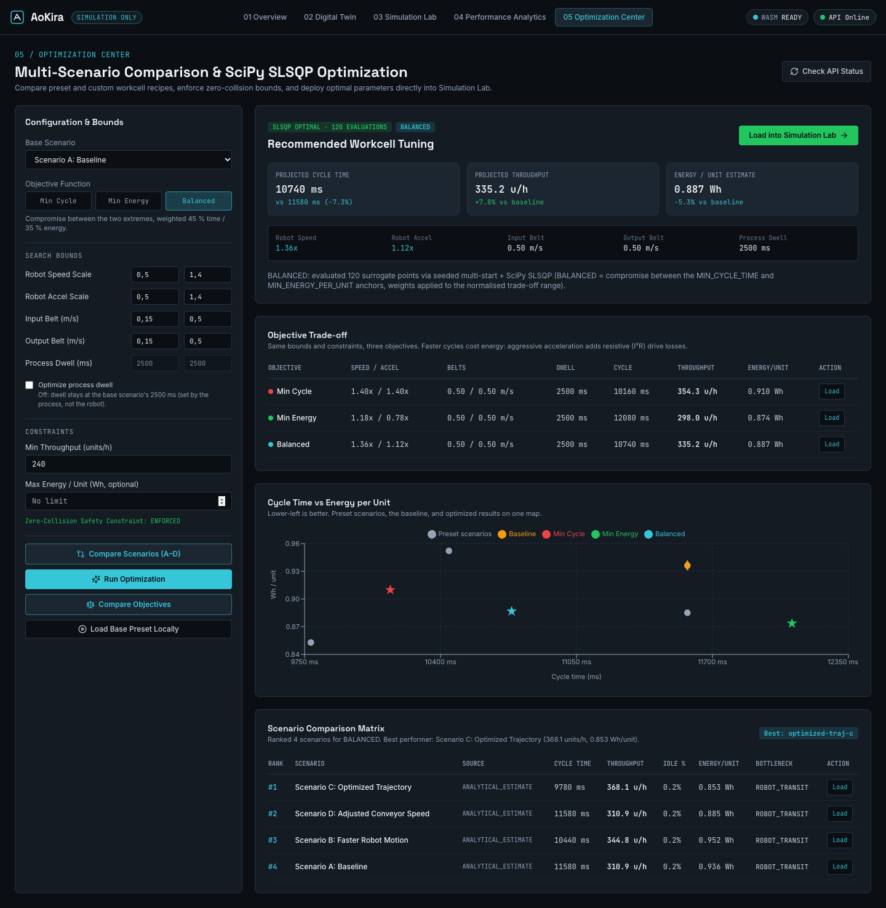
<sub>Halaman penuh setelah <b>Run Optimization</b> (Balanced), <b>Compare Objectives</b>, dan <b>Compare Scenarios</b> (full stack)</sub>

**Compare Objectives.** Batas dan kendala yang sama, tiga objektif, berdampingan. Di sini dwell dikunci pada 2500 ms. Min Cycle mendorong kecepatan dan akselerasi ke batas (1.40× / 1.40×). Min Energy memperlambat lengan, terutama akselerasinya (1.18× / 0.78×), dan menghemat sekitar 4 % energi per bagian dengan throughput 16 % lebih rendah. Balanced berada di antaranya.

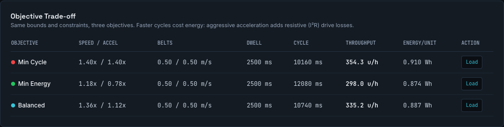

**Trade-off map.** Waktu siklus terhadap energi per bagian untuk skenario preset, baseline, dan tiap hasil optimasi; kiri-bawah adalah yang terbaik.

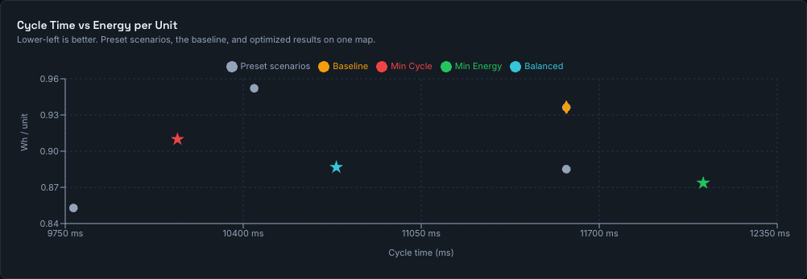

<table>
<tr>
<td width="50%">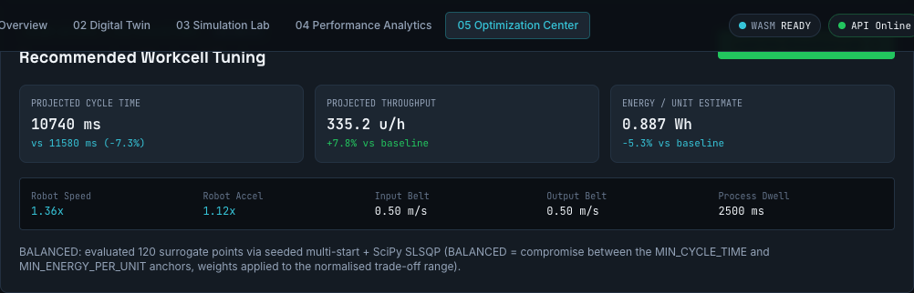<br><sub>Kartu rekomendasi dengan <code>Load into Simulation Lab</code></sub></td>
<td width="50%">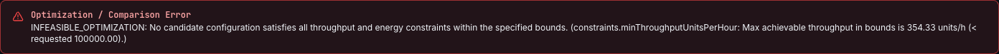<br><sub>Kendala mustahil (min throughput 100.000 u/h) mengembalikan diagnostik <b>INFEASIBLE_OPTIMIZATION</b></sub></td>
</tr>
<tr>
<td width="50%">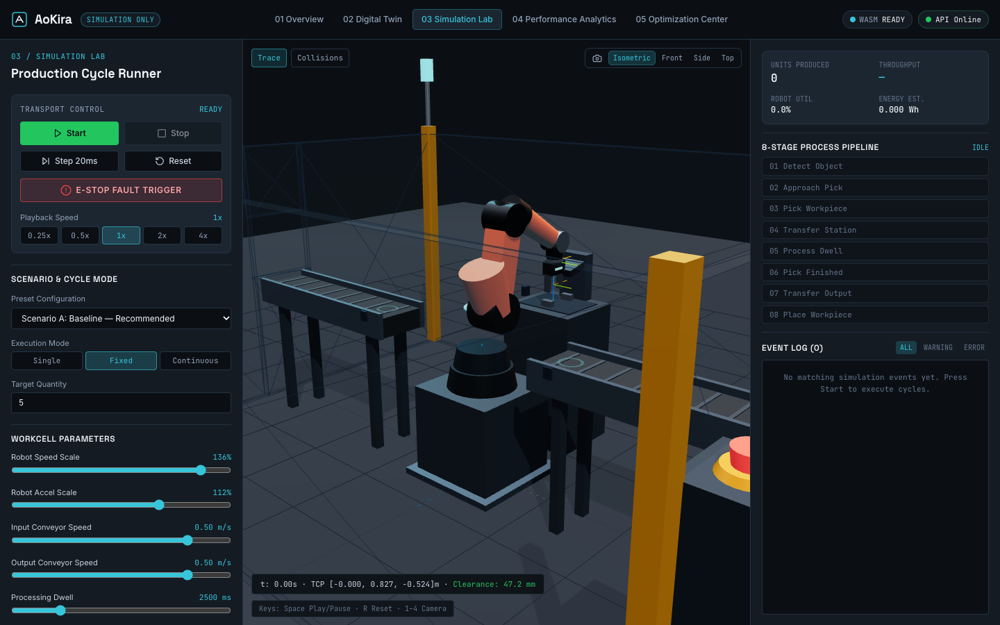<br><sub>Parameter teroptimasi dimuat ke <b>Simulation Lab</b> sebagai <code>*-optimized</code> (full stack)</sub></td>
<td width="50%">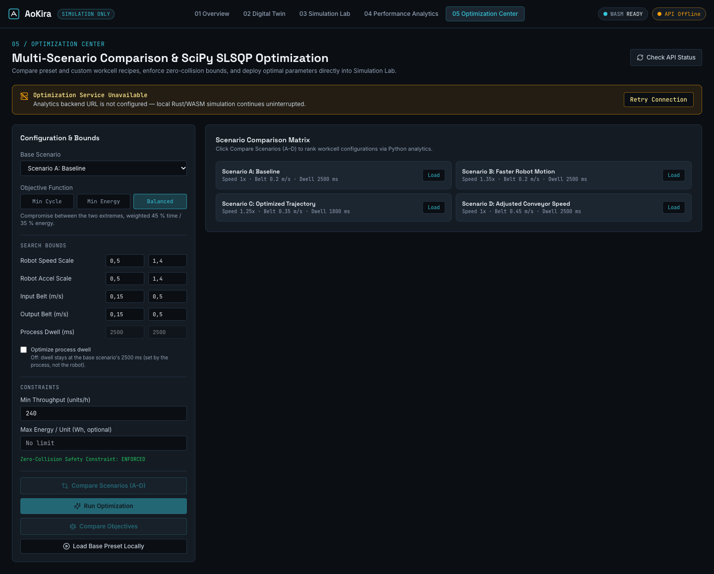<br><sub>Di GitHub Pages, aksi Python dinonaktifkan dan banner yang jelas ditampilkan (live)</sub></td>
</tr>
</table>

---

### Tampilan mobile

Layout responsif hingga 390 px. Navigasi berpindah ke drawer hamburger, dan viewport 3D bertumpuk di atas panel.

<table>
<tr>
<td width="25%">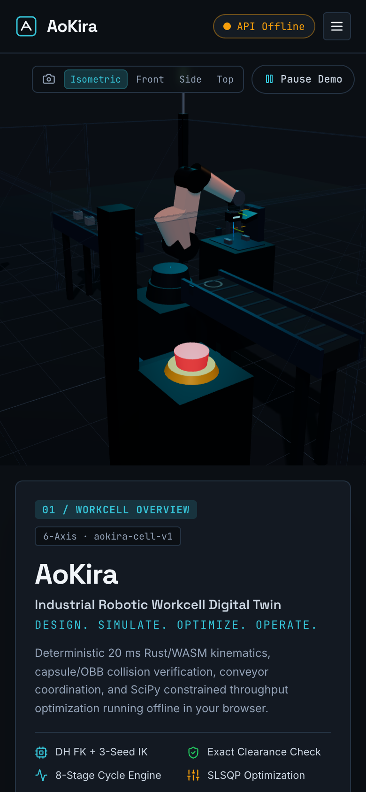<br><sub>Overview</sub></td>
<td width="25%">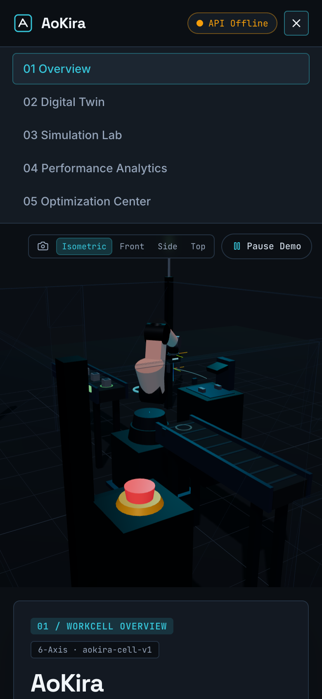<br><sub>Drawer navigasi</sub></td>
<td width="25%">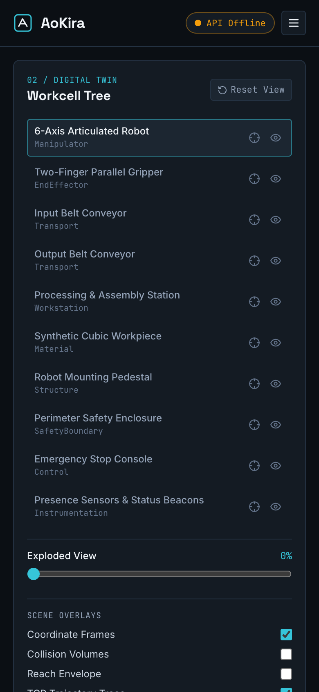<br><sub>Digital Twin</sub></td>
<td width="25%">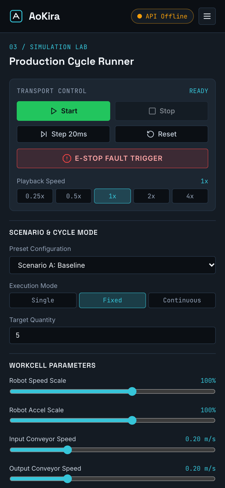<br><sub>Simulation Lab</sub></td>
</tr>
</table>

### REST API (Swagger)

Layanan FastAPI menyajikan dokumentasi OpenAPI interaktif di `/api/v1/docs`.

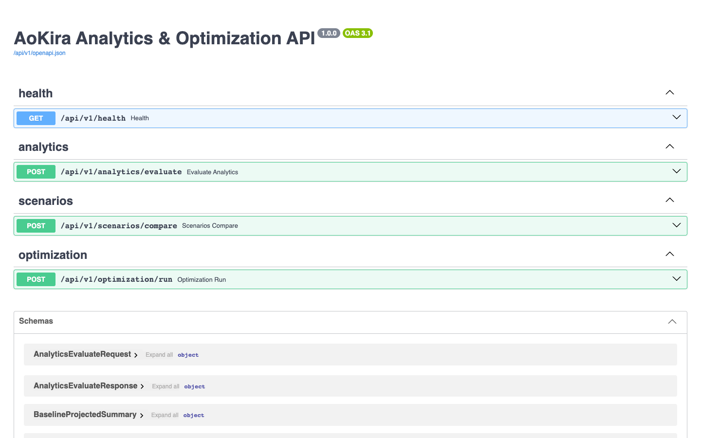

| Method | Endpoint | Fungsi |
|---|---|---|
| `GET` | `/api/v1/health` | Pemeriksaan kesehatan layanan dan versi kontrak |
| `POST` | `/api/v1/analytics/evaluate` | Memvalidasi aliran event, menghitung ulang KPI, bottleneck, rincian energi, prakiraan 8 jam |
| `POST` | `/api/v1/scenarios/compare` | Meranking skenario A–D (atau kustom) berdasarkan objektif |
| `POST` | `/api/v1/optimization/run` | Pencarian parameter berkendala dengan SciPy SLSQP + multi-start |

Skema request dan response lengkap serta kode error (`VALIDATION_ERROR`, `INVALID_EVENT_SEQUENCE`, `INFEASIBLE_OPTIMIZATION`, `INTERNAL_ERROR`) ada di [API_CONTRACT.md](docs/id/API_CONTRACT.md).

---

## Preset skenario

Didefinisikan di [`data/scenarios/`](data/scenarios) dan dipakai bersama oleh engine, API, dan UI.

| ID | Nama | Kecepatan robot | Akselerasi robot | Belt input / output | Dwell proses | Tujuan |
|---|---|---|---|---|---|---|
| `baseline-a` | Scenario A: Baseline | 1.00× | 1.00× | 0.20 / 0.20 m/s | 2500 ms | Parameter default kanonis |
| `faster-robot-b` | Scenario B: Faster Robot Motion | 1.35× | 1.30× | 0.20 / 0.20 m/s | 2500 ms | Manipulator lebih cepat, konveyor sama |
| `optimized-traj-c` | Scenario C: Optimized Trajectory | 1.25× | 1.15× | 0.35 / 0.35 m/s | 1800 ms | Gerakan lebih halus, feed lebih cepat, dwell lebih singkat |
| `conveyor-tuned-d` | Scenario D: Adjusted Conveyor Speed | 1.00× | 1.00× | 0.45 / 0.45 m/s | 2500 ms | Belt lebih cepat untuk menghindari starvation |

Semua preset menargetkan **330 unit/jam** (takt ≈ 10,9 s), sedikit di atas kemampuan sel baseline (~311 u/h). Ini menjaga KPI *production efficiency* tetap bermakna: baseline mencapai sekitar 90 %, dan konfigurasi yang disetel mencapai 100 %.

Sumber kebenaran tunggal untuk geometri, parameter DH, batas sendi, dan metadata komponen adalah [`data/workcell/aokira-workcell.v1.json`](data/workcell/aokira-workcell.v1.json).

---

## Model energi & optimizer

Engine menjumlahkan daya sintetis pada setiap tick 20 ms ([SIMULATION_SPEC.md §7.2](docs/id/SIMULATION_SPEC.md)):

```
P = 120 W idle
  + Σ joints ( 0.35·τ·|q̇| + 0.04·τ·|q̈| + 0.010·τ·q̈² )   ← q̈² = rugi penggerak resistif (I²R)
  + 18 W/kg · m_held · max(‖q̇‖, 0.1)                      ← payload
  + 65 W per konveyor yang berjalan + 180 W saat stasiun memproses
```

**Suku I²R** inilah yang menciptakan trade-off nyata. Tanpanya, daya idle mendominasi dan pengaturan tercepat selalu yang paling efisien, sehingga setiap objektif memilih sudut yang sama. Dengan suku itu, energi per bagian memiliki minimum berbentuk U di sekitar kecepatan 1.0×. Angka di bawah berasal dari engine Rust (`cargo run --release --example energy_sweep`; belt 0,5 m/s, dwell 1200 ms):

| Kecepatan = akselerasi | 0.5× | 0.8× | **1.0×** | 1.2× | 1.4× |
|---|---|---|---|---|---|
| Waktu siklus | 15,6 s | 11,5 s | 10,3 s | 9,4 s | 8,9 s |
| Energi / bagian | 0,868 Wh | 0,780 Wh | **0,772 Wh** | 0,781 Wh | 0,797 Wh |

**Optimizer** bekerja dalam tiga langkah:

1. Memakai **surrogate** bentuk tertutup dari engine ([`surrogate.py`](apps/api/app/analytics/surrogate.py)) yang mengintegrasikan suku daya yang sama pada setiap segmen quintic. Surrogate memakai batas sendi kanonis (diperiksa oleh sebuah tes) dan dikalibrasi terhadap engine: selisihnya tetap dalam 1 % untuk waktu siklus dan 0,8 % untuk energi pada grid 60 titik.
2. Menjalankan pencarian multi-start ber-seed diikuti **SciPy SLSQP** dalam koordinat ternormalisasi. `Min Energy` mendarat dalam 0,1 % dari acuan global `differential_evolution`.
3. Untuk `Balanced`, ia lebih dulu menemukan dua ekstrem (tercepat dan terhemat), menskalakan waktu siklus dan energi dengan selisih nyata antar keduanya, lalu menerapkan bobot.

---

## Cara kerjanya

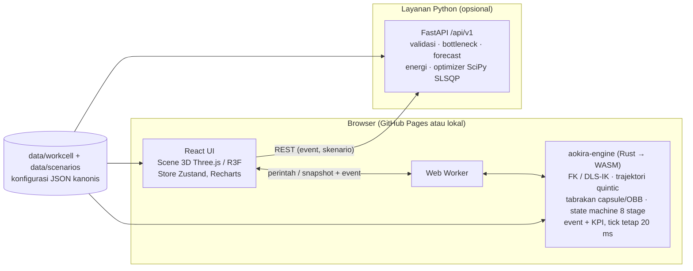

**Siklus produksi (state machine 8 stage):**

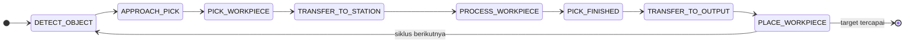

Poin desain utama:

1. **Determinisme.** Konfigurasi workcell dan skenario yang sama (termasuk seed) menghasilkan aliran event, waktu, dan KPI yang sama, berapa pun refresh rate layar. Sebuah golden fixture yang di-commit ([`data/fixtures/baseline-3cycles.golden.json`](data/fixtures/baseline-3cycles.golden.json)) menjaganya di CI.
2. **Di luar thread UI.** Engine berjalan di dalam Web Worker khusus. Snapshot langsung disimpan di ref di luar state React, sehingga scene 3D dirender pada frame rate penuh. Pada WebGL berbasis CPU (VM, akselerasi GPU dimatikan), scene otomatis melepas environment map dan bayangan agar tetap interaktif.
3. **Degradasi yang anggun.** Pemanggilan API punya timeout ketat (3 s / 10 s / 20 s). Jika API gagal, UI menampilkan badge offline yang jelas, dan simulasinya sendiri tidak pernah berhenti.
4. **Paritas kontrak.** Tipe TypeScript dan skema Pydantic v2 saling mencerminkan dalam camelCase. API menghitung ulang KPI dan melaporkan selisih client/server (`< 0,01 %`).

Pembahasan mendalam: [SIMULATION_SPEC.md](docs/id/SIMULATION_SPEC.md) (frame, tabel DH, IK, trajektori, tabrakan, state machine, model energi) dan [ARCHITECTURE.md](docs/id/ARCHITECTURE.md).

---

## Tech stack

| Layer | Teknologi |
|---|---|
| **Frontend** | TypeScript (strict), React 18, Vite, Three.js, `@react-three/fiber`, `@react-three/drei`, Zustand, Tailwind CSS, Recharts, lucide-react |
| **Inti simulasi** | Rust, `wasm-bindgen`, `serde`, `wasm-pack`, Web Workers |
| **Analytics dan optimasi** | Python 3.12, FastAPI, Pydantic v2, NumPy, SciPy (SLSQP), Uvicorn |
| **Pengujian** | `cargo test` + clippy + rustfmt, pytest + ruff, Vitest + Testing Library, Playwright (Chrome WebGL) |
| **Pengiriman** | GitHub Actions → GitHub Pages (frontend + WASM), image Docker untuk API |

---

## Struktur repositori

```text
AoKira/
├── .github/workflows/ci-deploy.yml  # Rust/WASM · Python + smoke Docker · Web + E2E · deploy Pages
├── apps/
│   ├── web/                         # Frontend React + R3F, jembatan Web Worker
│   │   ├── src/features/            # overview · digital-twin · simulation · analytics · optimization
│   │   ├── src/components/scene/    # model 3D workcell, rig kamera, environment
│   │   ├── src/workers/             # simulation.worker.ts (membungkus engine WASM)
│   │   ├── e2e/                     # Playwright E2E-01..05
│   │   └── screenshots/             # Capture screenshot README dengan Playwright
│   └── api/                         # Analytics FastAPI & optimasi SciPy + Dockerfile
├── crates/aokira-engine/            # Inti simulasi Rust → WASM (+ contoh perf_bench)
├── data/
│   ├── workcell/                    # aokira-workcell.v1.json (sumber kebenaran tunggal)
│   ├── scenarios/                   # Preset Scenario A–D
│   └── fixtures/                    # Fixture regresi deterministik golden
├── docs/
│   ├── screenshots/                 # Gambar yang dipakai di README ini
│   └── id/                          # Dokumentasi Bahasa Indonesia
├── scripts/
│   ├── build-wasm.sh                # Membangun WASM ke apps/web/src/wasm
│   └── test-all.sh                  # Verifikasi terpadu Rust + Python + Web
└── *.md                             # PRD, arsitektur, spesifikasi, kontrak, desain, rencana tes (Inggris)
```

---

## Memulai

### Prasyarat

- **Node.js ≥ 20** dan npm
- **Rust** stable + `wasm-pack` (`rustup target add wasm32-unknown-unknown`)
- **Python ≥ 3.12**
- **Google Chrome** (untuk E2E Playwright dan screenshot)
- Docker (opsional)

### 1 · Bangun engine WASM

```bash
./scripts/build-wasm.sh
```

### 2 · Jalankan API Python (opsional, mengaktifkan fitur Python)

```bash
cd apps/api
python3 -m venv .venv && source .venv/bin/activate
pip install -e ".[dev]"
uvicorn app.main:app --reload --port 8000
```

Atau dengan Docker:

```bash
docker build -t aokira-api apps/api && docker run -p 8000:8000 aokira-api
```

### 3 · Jalankan aplikasi web

```bash
cd apps/web
npm install
VITE_API_BASE_URL=http://127.0.0.1:8000 npm run dev
```

Buka http://localhost:5173. Jika `VITE_API_BASE_URL` tidak diisi, aplikasi berjalan dalam mode browser-saja, persis seperti build GitHub Pages.

### Variabel lingkungan

| Variabel | Lokasi | Fungsi |
|---|---|---|
| `VITE_API_BASE_URL` | build web | Base URL FastAPI. Jika tidak diatur, aplikasi berjalan offline (hanya WASM). |
| `VITE_BASE_PATH` | build web | Base path publik (`/AoKiraDeck/` untuk GitHub Pages) |
| `AOKIRA_CORS_ORIGINS` | API | Origin yang diizinkan, dipisah koma (default: dev/preview localhost + `https://orls967.github.io`) |

Untuk menghubungkan build Pages yang di-host ke API yang sudah di-deploy, atur variabel repositori **`VITE_API_BASE_URL`** (*Settings → Secrets and variables → Actions → Variables*) lalu jalankan ulang workflow.

---

## Pengujian & CI/CD

```bash
./scripts/test-all.sh          # Rust fmt + clippy + tes, Python ruff + pytest, Web typecheck + Vitest + build
```

Jalankan langkahnya satu per satu:

```bash
cd crates/aokira-engine
cargo fmt --check && cargo clippy --all-targets -- -D warnings && cargo test
cargo run --release --example perf_bench
```

```bash
cd apps/api && ruff check . && pytest
```

```bash
cd apps/web && npm run typecheck && npm run test && npm run test:e2e   # E2E butuh API di :8000 + `npm run preview`
```

| Suite | Cakupan |
|---|---|
| **Rust** (23 tes) | FK pose home dan ekstrem, round-trip IK dan kasus tak terjangkau, batas kecepatan/akselerasi quintic, primitif tabrakan dan near-miss, state machine produksi, regresi golden fixture, nol tabrakan di semua 16 sudut rentang parameter yang diizinkan |
| **Python** (13 tes) | Smoke + kontrak API `API-01..07`: health & CORS, evaluate (paritas golden-fixture), penolakan input tidak valid, ranking skenario, optimasi dalam batas, error domain infeasible, statelessness/determinisme. `API-08..10`: konstanta surrogate cocok dengan konfigurasi workcell, surrogate dalam 2 % dari golden fixture Rust, tiga objektif memberi hasil berbeda dengan Balanced di antaranya, Min Energy mencapai optimum global, dwell terkunci dihormati |
| **Web** (14 tes) | `FE-01..05`: transport/fault Simulation Lab, tree & pemilihan Digital Twin, Analytics kosong + offline, Optimization compare/run/infeasible/dwell lock/Compare Objectives, reduced-motion & fallback 2D WebGL, routing & pemuatan konfigurasi |
| **E2E** (5 tes) | `E2E-01..05` di Chrome + WebGL sungguhan terhadap Uvicorn: overview, twin, siklus penuh → analytics, optimasi (termasuk tiga hasil objektif berbeda) + offline, mobile 390×844 |

**GitHub Actions** ([`ci-deploy.yml`](.github/workflows/ci-deploy.yml)) berjalan pada setiap push dan PR ke `main`: `rust-and-wasm` → `python-api` (termasuk smoke test kesehatan Docker) → `web-and-e2e` (termasuk Playwright dan bundle Pages `/AoKiraDeck/` dengan fallback SPA `404.html`) → `deploy-pages` (hanya di `main`).

### Membuat ulang screenshot

```bash
cd apps/web
# GitHub Pages live (tampilan browser-saja, mobile)
SHOTS_TARGET=pages SHOTS_BASE_URL=https://orls967.github.io/AoKiraDeck/ npm run screenshots
# Full stack lokal (API berjalan di :8000, build disajikan di :4174)
SHOTS_TARGET=api SHOTS_BASE_URL=http://127.0.0.1:4174/ npm run screenshots
```

Gambar ditulis ke `docs/screenshots/`.

---

## Performa terukur

Diukur pada mesin Apple Silicon lokal (baseline Phase 7):

| Metrik | Hasil |
|---|---|
| Rust: 1.000 tick simulasi (`perf_bench --release`) | `22,9 ms` total (`0,023 ms/tick`) |
| Rust: DLS IK 3-seed, terjangkau | `0,0133 ms` rata-rata / `0,0148 ms` terburuk |
| Rust: penolakan IK tak terjangkau | `0,0013 ms` |
| FastAPI `POST /analytics/evaluate`, 1.000 event | `22,6 ms` |
| FastAPI `POST /optimization/run`, SLSQP | `7,8 ms` |
| Frame rate canvas WebGL (`E2E-01`) | `~60 FPS` pada GPU; `6–12 FPS` pada WebGL berbasis CPU (SwiftShader) berkat kualitas adaptif |
| Biner WASM (`aokira_engine_bg.wasm`) | `270 kB` mentah / `109 kB` gzip |
| JS halaman pembuka | Recharts (`113 kB` gzip) dimuat lazy hanya di Analytics / Optimization |

---

## Indeks dokumentasi

Dokumen Bahasa Indonesia ada di [`docs/id/`](docs/id). Versi aslinya (Inggris) ada di root repositori.

| Dokumen | Isi |
|---|---|
| [PRD.md](docs/id/PRD.md) | Visi, persona, user journey, cakupan, pengecualian, kriteria penerimaan `AC-01`–`AC-18` |
| [DATA_MODEL.md](docs/id/DATA_MODEL.md) | Entitas kanonis, satuan, event, metrik, kepemilikan |
| [SIMULATION_SPEC.md](docs/id/SIMULATION_SPEC.md) | Frame, DH/FK/IK, perencanaan quintic, tabrakan, state machine, energi |
| [ARCHITECTURE.md](docs/id/ARCHITECTURE.md) | Topologi 3 tier, protokol worker, tata letak modul, deployment |
| [API_CONTRACT.md](docs/id/API_CONTRACT.md) | Endpoint `/api/v1`, skema, envelope error, aturan offline |
| [DESIGN.md](docs/id/DESIGN.md) | Token visual, tipografi, layout halaman, aksesibilitas, reduced motion, fallback WebGL |
| [TEST_PLAN.md](docs/id/TEST_PLAN.md) | Suite tes, protokol baseline, matriks verifikasi AC |
| [flow.md](docs/id/flow.md) | Roadmap Phase 0–8 dan gerbang validasi |
| [constraints.md](docs/id/constraints.md) | Invarian rekayasa dan guardrail |
| [IMPLEMENTATION_PROGRESS.md](docs/id/IMPLEMENTATION_PROGRESS.md) | Log pengiriman per phase dan keputusan teknis |

---

## Keterbatasan yang diketahui

1. **Fisika dan energi sintetis.** Transportasi konveyor, penempelan grasp kaku, tabrakan capsule/box, dan estimasi daya adalah model demonstrator yang disederhanakan. Ini bukan fisika rigid-body, kontak akurat-mesh, maupun pengukuran terkalibrasi.
2. **Demo yang di-host tidak punya backend.** GitHub Pages hanya menyajikan file statis, jadi pengayaan Python dan optimasi membutuhkan API yang berjalan lokal (atau di-deploy terpisah).
3. **Daya konveyor tidak bergantung pada kecepatan.** Sebuah belt menarik 65 W setiap kali berjalan, sehingga belt yang lebih cepat selalu tampak sedikit lebih murah, dan belt tidak pernah membatasi throughput di sel ini. Karena itu optimizer selalu memilih belt tercepat.
4. **API stateless.** Tidak ada akun pengguna, persistensi, atau kolaborasi multi-pengguna.
5. **Input mengikuti locale.** Input numerik mengikuti locale browser (misalnya `0,5` alih-alih `0.5`).

---

<div align="center">
<sub>AoKira: demonstrator rekayasa khusus simulasi. Tidak untuk mengendalikan peralatan sungguhan.</sub>
</div>
