<div align="center">

# AoKira

### Industrial Robotic Workcell Digital Twin

**Design. Simulate. Optimize. Operate.**

Interactive 3D manufacturing simulation, robot motion planning and production optimization: entirely in the browser.

[](https://github.com/Orls967/AoKira/actions/workflows/ci-deploy.yml)
[](https://orls967.github.io/AoKira/)


**[▶ Open the live demo](https://orls967.github.io/AoKira/)**

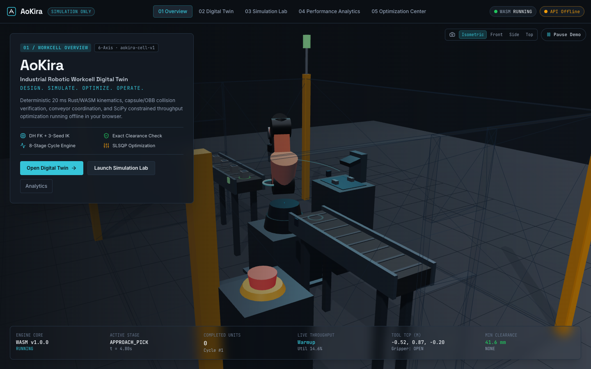

</div>

> [!IMPORTANT]
> **Simulation only.** AoKira is a deterministic, synthetic engineering demonstrator. It is **not** robot control firmware, PLC/ROS 2 middleware, a certified safety system (ISO 10218 / ISO/TS 15066), or calibrated electrical metering. Every energy figure is labelled *"Synthetic engineering estimate only; not real electrical metering."*

---

## Contents

- [What is AoKira?](#what-is-aokira)
- [Live demo & run modes](#live-demo--run-modes)
- [Feature tour (screenshots)](#feature-tour)
  - [01 · Overview](#01--overview)
  - [02 · Digital Twin](#02--digital-twin)
  - [03 · Simulation Lab](#03--simulation-lab)
  - [04 · Performance Analytics](#04--performance-analytics)
  - [05 · Optimization Center](#05--optimization-center)
  - [Mobile layout](#mobile-layout)
  - [REST API (Swagger)](#rest-api-swagger)
- [Scenario presets](#scenario-presets)
- [How it works](#how-it-works)
- [Tech stack](#tech-stack)
- [Repository structure](#repository-structure)
- [Getting started](#getting-started)
- [Testing & CI/CD](#testing--cicd)
- [Measured performance](#measured-performance)
- [Documentation index](#documentation-index)
- [Known limitations](#known-limitations)

---

## What is AoKira?

Evaluating an automated pick-and-place cell usually means expensive offline-programming suites, or a scattered set of tools where kinematics, cycle-time estimates, collision checks and throughput optimization each live in a different spreadsheet or viewer. Lightweight web 3D demos, on the other hand, rarely have real kinematics, collision validation or a traceable event log behind them.

AoKira brings all of this together around **one deterministic simulation core** for a single virtual workcell: a generic 6-axis articulated robot with a two-finger gripper, input and output belt conveyors, a processing station, a safety enclosure, sensors and an E-stop console.

- **Every motion is computed.** Standard-DH forward kinematics, 3-seed damped-least-squares inverse kinematics, quintic joint trajectories, and capsule/OBB collision checking with a 25 mm near-miss threshold. All of it is written in **Rust, compiled to WebAssembly**, and runs on a fixed 20 ms clock in a Web Worker.
- **Every KPI comes from events.** Throughput, cycle time, utilization, idle time, downtime, collisions and synthetic energy are derived from the engine's event stream. Nothing is mocked.
- **What-if optimization.** A stateless **Python/FastAPI** service checks the KPIs, finds the bottleneck, forecasts an 8-hour shift, compares scenarios and runs **SciPy SLSQP** constrained optimization. You can load the result back into the simulator with one click.
- **Works offline.** The 3D twin and the full production simulation keep running in the browser even when the Python backend is unreachable.

**Built for:** automation engineers checking reach, clearance and cycle time; robotics students studying FK/IK, trajectory planning and event-driven twins; and operations analysts comparing what-if scenarios.

---

## Live demo & run modes

| Mode | What runs | What you get |
|---|---|---|
| **[GitHub Pages](https://orls967.github.io/AoKira/)** (static) | React UI + Rust/WASM engine in your browser | Overview, Digital Twin, Simulation Lab, event-derived Analytics KPIs and charts. The status pill shows `API Offline`, and Python-only panels show a graceful *Backend Unavailable* state. |
| **Local full stack** | The above + FastAPI service on `:8000` | Everything, including Python bottleneck/forecast/energy enrichment, scenario comparison and SLSQP optimization. |

> Screenshots marked **(live)** were captured from the deployed GitHub Pages site. Screenshots marked **(full stack)** were captured from a local build connected to the FastAPI service. All of them come from [`apps/web/screenshots/capture.spec.ts`](apps/web/screenshots/capture.spec.ts) (see [Regenerating screenshots](#regenerating-screenshots)).

---

## Feature tour

The app has five pages, numbered in the top navigation bar. On the right of the bar, two status pills show the WASM engine state (`BOOTING` / `READY` / `RUNNING` / `PAUSED` / `COMPLETED` / `FAULTED`) and the API connection (`API Online` / `API Offline`).

### 01 · Overview

The landing page. A cinematic 3D view of the workcell runs a live pick-and-place demo on the real WASM engine, with a launch card and a telemetry strip along the bottom.

| Control | Options |
|---|---|
| Camera presets | `Isometric` · `Front` · `Side` · `Top` (the camera orbits slowly when idle) |
| Demo transport | `Pause Demo` / `Resume Demo` |
| Shortcuts | `Open Digital Twin` · `Launch Simulation Lab` · `Analytics` |

<table>
<tr>
<td width="50%">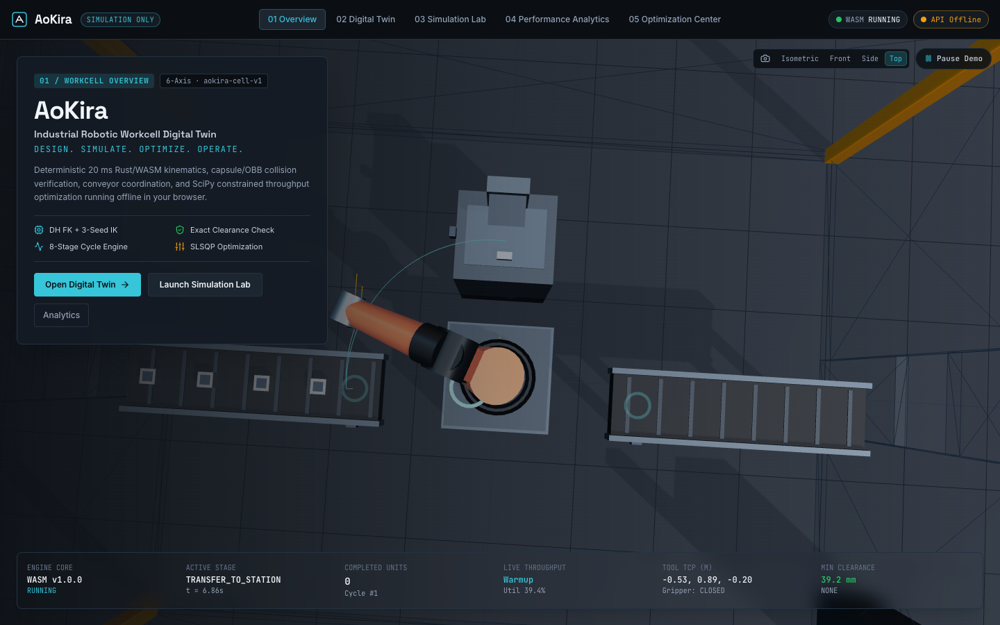<br><sub><b>Top</b> camera preset (live)</sub></td>
<td width="50%">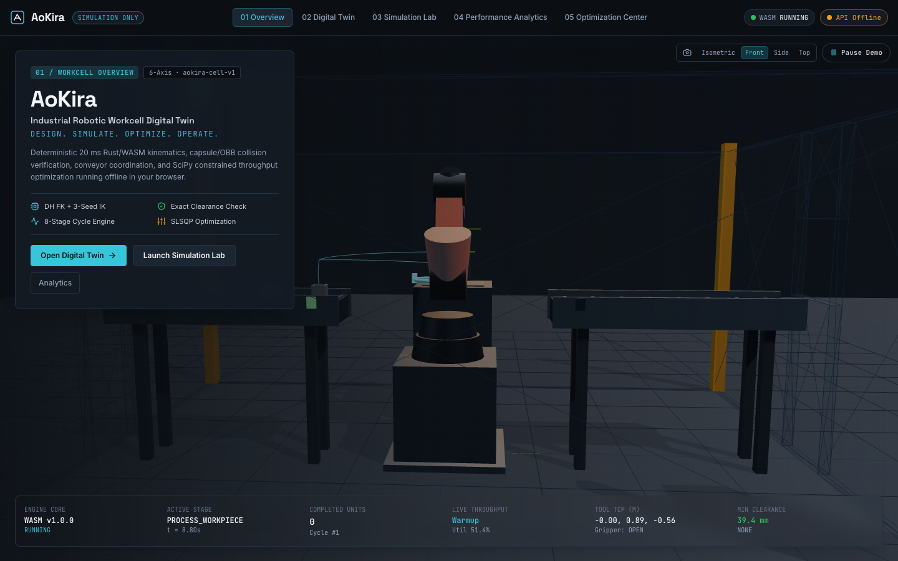<br><sub><b>Front</b> camera preset (live)</sub></td>
</tr>
</table>

The telemetry strip updates on every engine tick: engine version, active stage and sim time, completed units, live throughput and utilization, tool TCP position and gripper state, and minimum collision clearance.

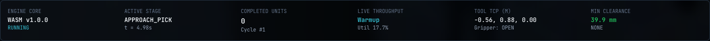

---

### 02 · Digital Twin

A CAD-style inspector for the whole workcell. It has three panels: the **Workcell Tree** on the left, the **3D viewport** in the centre, and the **component, joint and IK inspector** on the right.

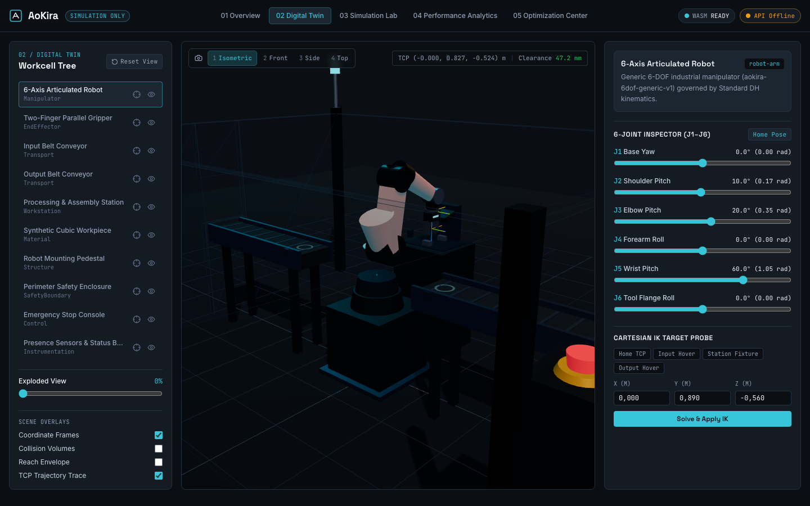
<sub>Default view: robot selected, home pose, coordinate frames and TCP trace on (live)</sub>

**Camera presets.** Use `1 Isometric` · `2 Front` · `3 Side` · `4 Top`, also available as keyboard shortcuts `1`–`4`. Orbit, pan and zoom with the mouse.

<table>
<tr>
<td width="25%">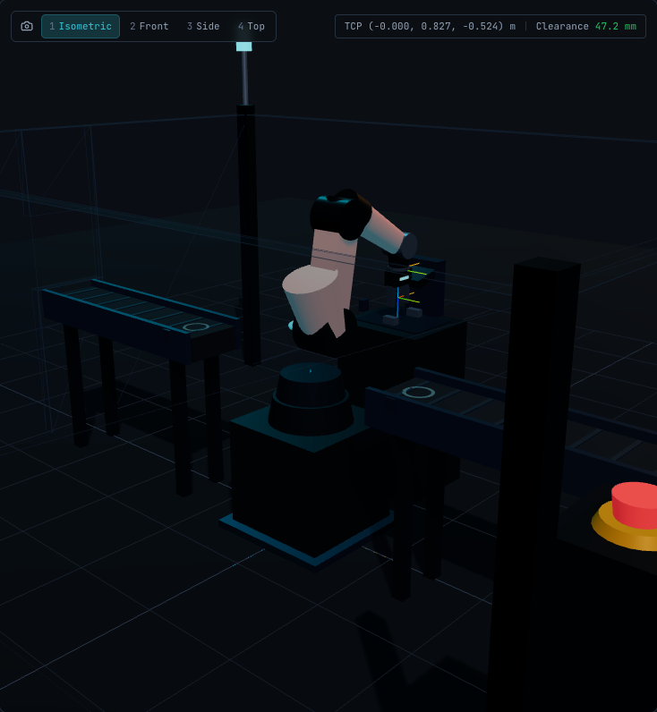<br><sub>1 · Isometric</sub></td>
<td width="25%">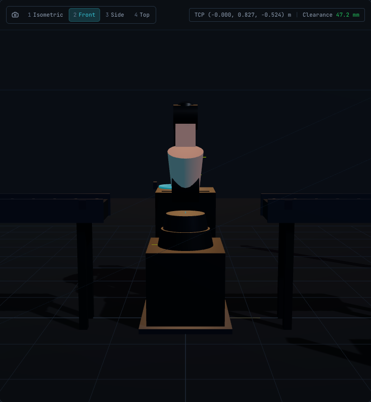<br><sub>2 · Front</sub></td>
<td width="25%">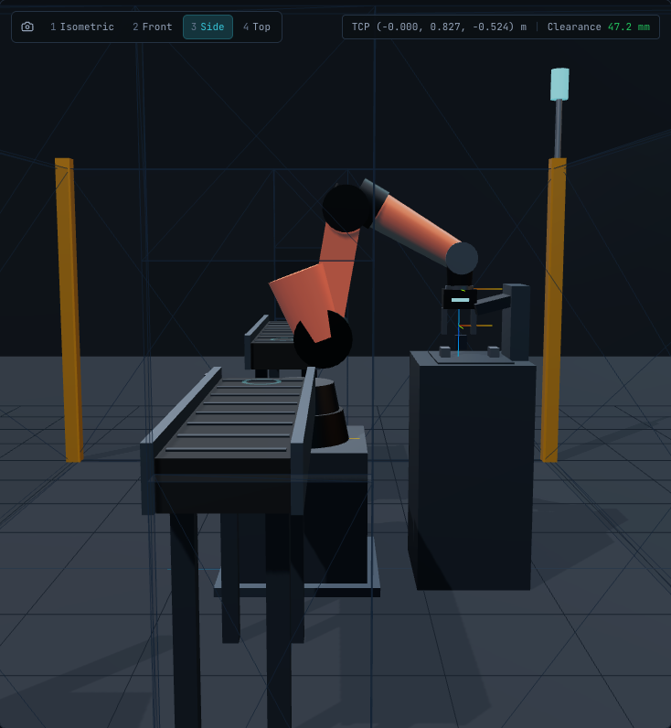<br><sub>3 · Side</sub></td>
<td width="25%">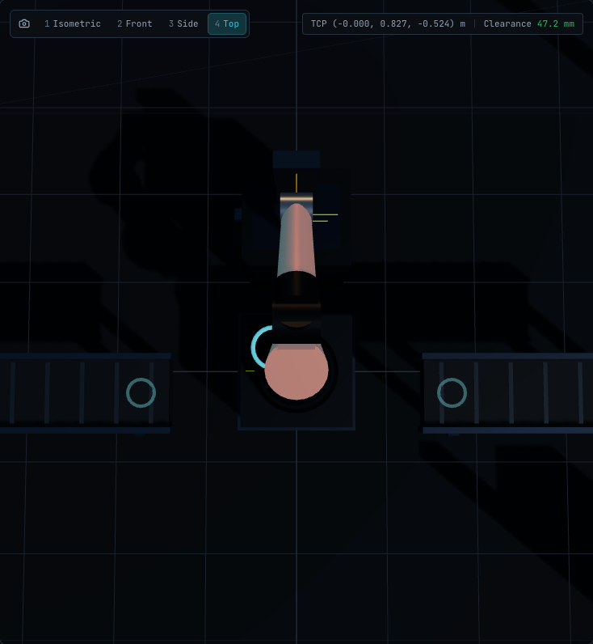<br><sub>4 · Top</sub></td>
</tr>
</table>

**Workcell Tree.** The tree lists all 10 components: 6-Axis Articulated Robot, Two-Finger Parallel Gripper, Input / Output Belt Conveyor, Processing & Assembly Station, Synthetic Cubic Workpiece, Robot Mounting Pedestal, Perimeter Safety Enclosure, Emergency Stop Console, and Presence Sensors & Status Beacon. Click a component to select it, use ⌖ to **isolate** it, or use 👁 to **show or hide** it. `Reset View` restores everything.

<table>
<tr>
<td width="50%">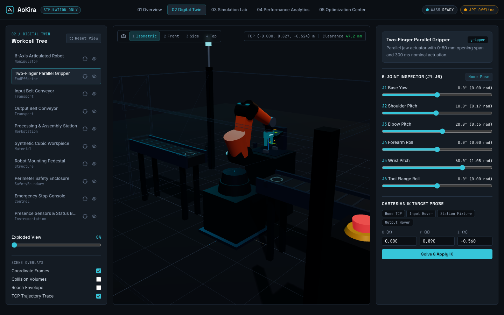<br><sub>Selecting the <b>gripper</b> highlights it and shows its spec card (live)</sub></td>
<td width="50%">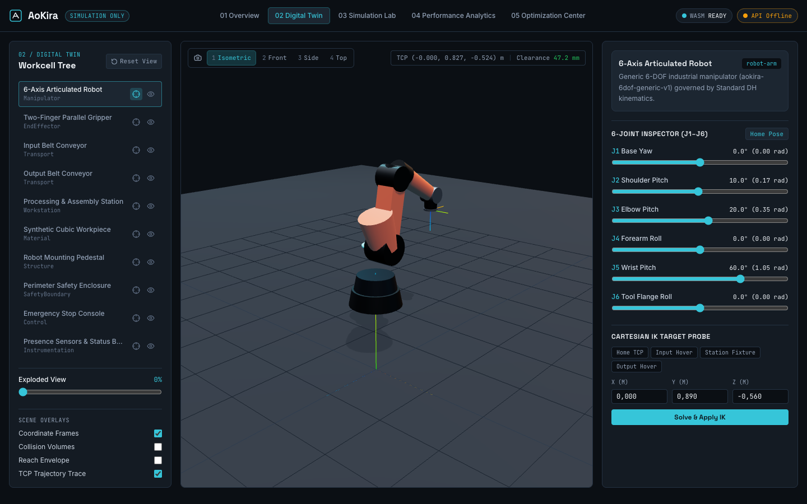<br><sub><b>Isolate</b> mode shows only the robot (live)</sub></td>
</tr>
</table>

**Scene overlays and exploded view.** Overlay toggles: `Coordinate Frames` · `Collision Volumes` · `Reach Envelope` · `TCP Trajectory Trace`. The `Exploded View` slider (0–100 %) spreads the assembly apart.

<table>
<tr>
<td width="50%">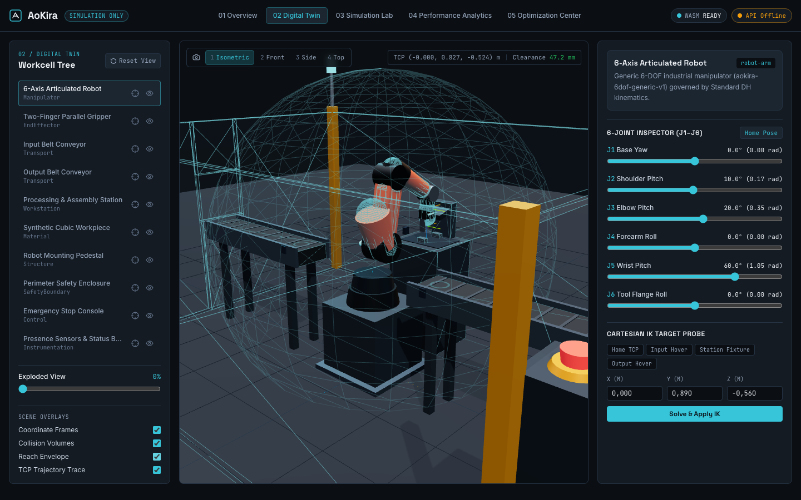<br><sub><b>Collision Volumes</b> + <b>Reach Envelope</b> enabled (live)</sub></td>
<td width="50%">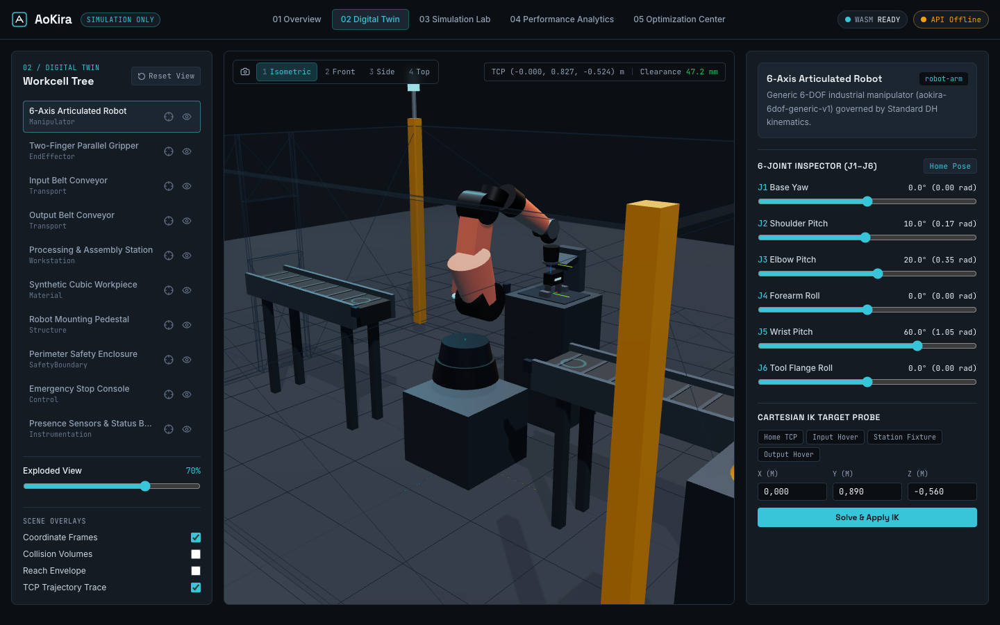<br><sub><b>Exploded View</b> at 70 % (live)</sub></td>
</tr>
</table>

**6-Joint Inspector (FK).** Jog `J1 Base Yaw`, `J2 Shoulder Pitch`, `J3 Elbow Pitch`, `J4 Forearm Roll`, `J5 Wrist Pitch` and `J6 Tool Flange Roll` within their joint limits. A readout turns amber when a joint is at its limit. `Home Pose` resets all joints.

**Cartesian IK Target Probe.** Type an `x / y / z` target in metres, or pick a quick preset (`Home TCP`, `Input Hover`, `Station Fixture`, `Output Hover`), then press `Solve & Apply IK`. Targets the robot cannot reach return a structured `UNREACHABLE_TARGET` error, and the live robot is not moved.

<table>
<tr>
<td width="33%">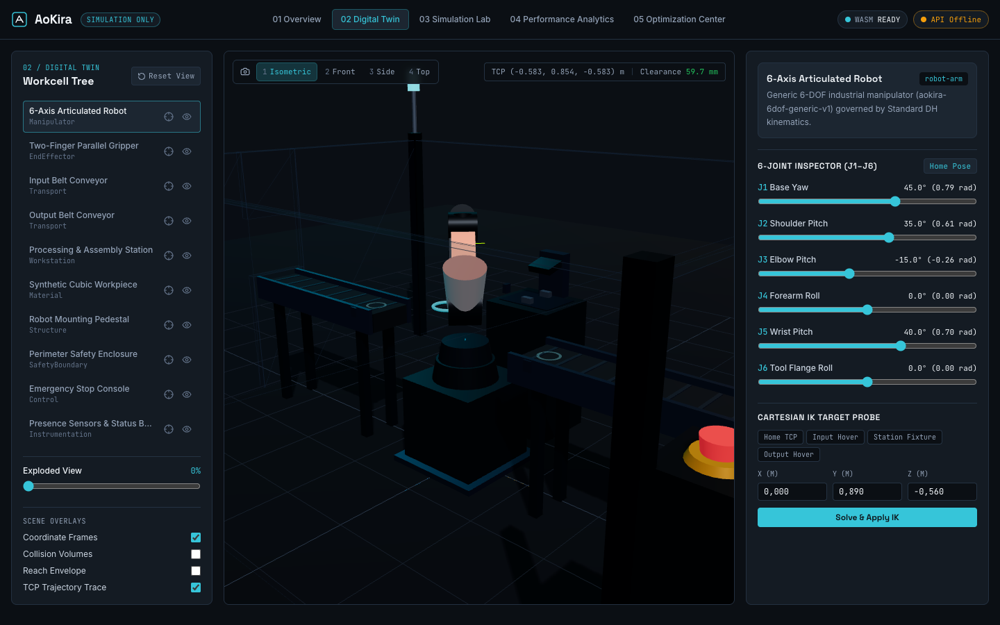<br><sub>Manual <b>joint jog</b> J1/J2/J3/J5 (live)</sub></td>
<td width="33%">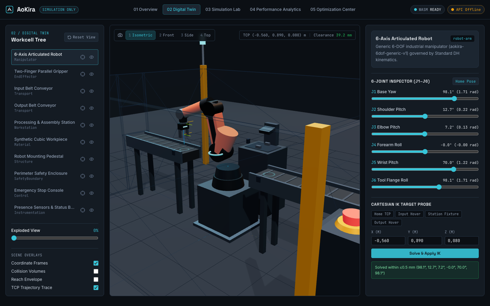<br><sub>IK solved for <b>Input Hover</b> (live)</sub></td>
<td width="33%">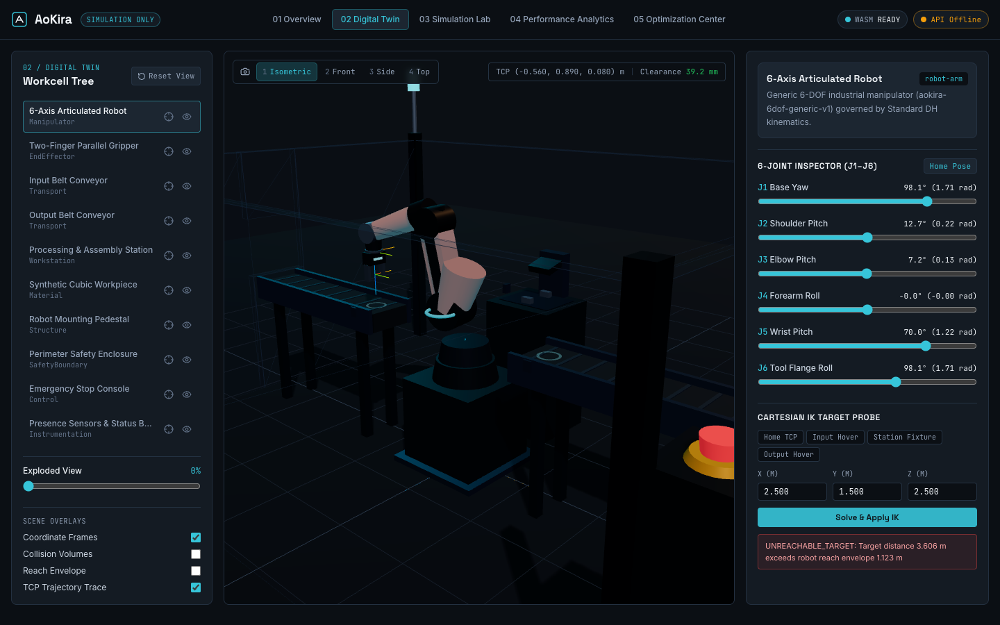<br><sub>Out-of-envelope target returns <b>UNREACHABLE_TARGET</b> (live)</sub></td>
</tr>
</table>

---

### 03 · Simulation Lab

The production control deck. The Rust/WASM engine runs the 8-stage pick-and-place state machine in fixed 20 ms steps. Playback speed only changes how many fixed steps run per frame, so results stay deterministic at any speed.

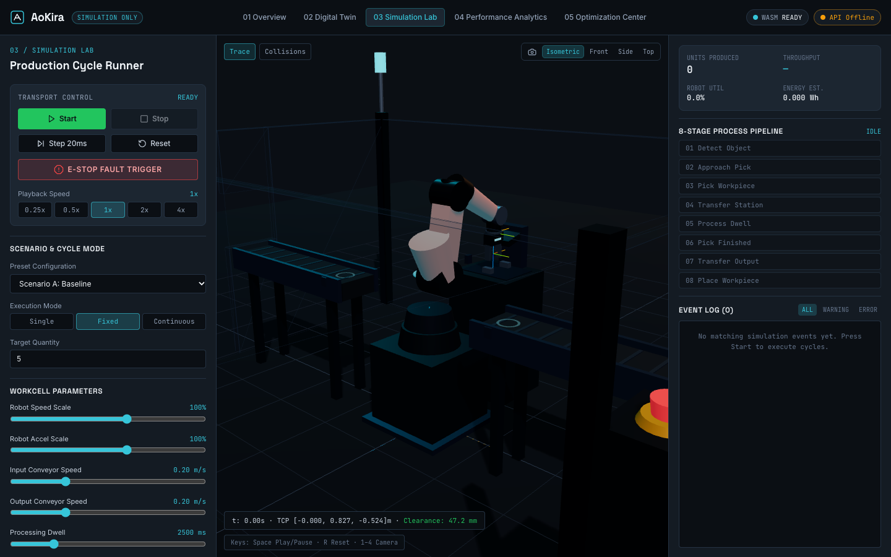
<sub>Ready state: transport deck, scenario and cycle mode, workcell parameters, 3D viewport, KPI tiles, pipeline and event log (live)</sub>

| Group | Options |
|---|---|
| **Transport control** | `Start` · `Pause` / `Resume` · `Stop` · `Step 20ms` · `Reset` · `E-Stop Fault Trigger` |
| **Playback speed** | `0.25x` · `0.5x` · `1x` · `2x` · `4x` |
| **Preset configuration** | Scenario A: Baseline · B: Faster Robot Motion · C: Optimized Trajectory · D: Adjusted Conveyor Speed (plus `*-optimized` once loaded from the Optimization Center) |
| **Execution mode** | `Single` (one cycle) · `Fixed` (target quantity 1–100) · `Continuous` |
| **Workcell parameters** | Robot speed and acceleration scale, input/output conveyor speed, processing dwell, workpiece mass (locked while running: *Stop/Reset to edit*) |
| **Viewport overlays** | `Trace` · `Collisions` · camera `Isometric / Front / Side / Top` |
| **Event log filter** | `ALL` · `WARNING` · `ERROR` |
| **Keyboard** | `Space` play/pause · `R` reset · `1`–`4` camera |

The **8-stage pipeline** highlights the active stage live: `01 Detect Object → 02 Approach Pick → 03 Pick Workpiece → 04 Transfer Station → 05 Process Dwell → 06 Pick Finished → 07 Transfer Output → 08 Place Workpiece`.

<table>
<tr>
<td width="50%">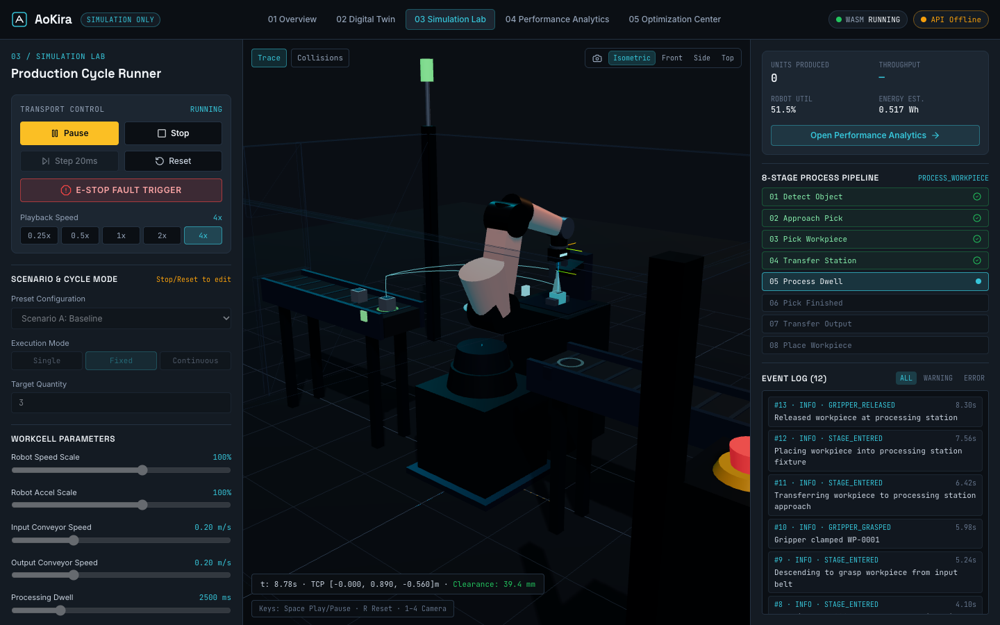<br><sub><b>Running</b> at 4x: robot carrying the billet to the station (live)</sub></td>
<td width="50%">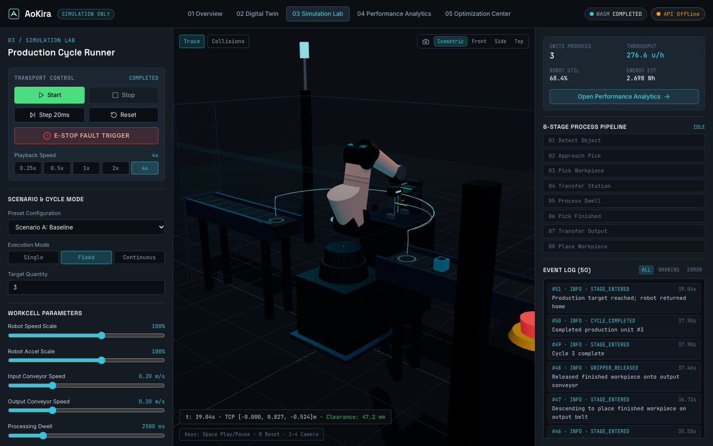<br><sub><b>Fixed</b> run of 3 cycles <b>COMPLETED</b> (live)</sub></td>
</tr>
<tr>
<td width="50%">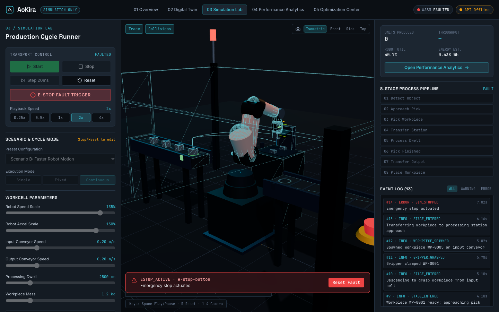<br><sub>Scenario B, <b>Continuous</b>, <b>Collisions</b> overlay, then <b>E-Stop</b>: fault banner with <code>Reset Fault</code> (live)</sub></td>
<td width="50%">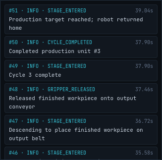<br><sub>Colour-coded, sequenced <b>event log</b> (live)</sub></td>
</tr>
</table>

---

### 04 · Performance Analytics

All KPIs are recomputed from the engine's event stream. When the API is reachable, `Analyze with Python Backend` adds bottleneck diagnosis, an 8-hour shift forecast, a synthetic energy breakdown and a client/server consistency check.

| State | Screenshot |
|---|---|
| **Empty**: no cycles yet, with a link to Simulation Lab | 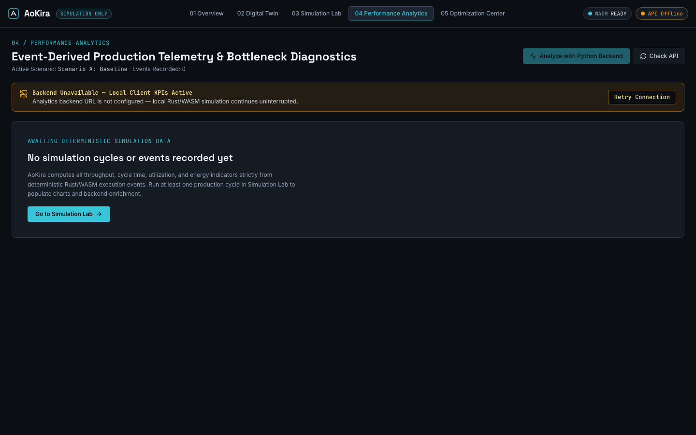 |
| **Offline** (GitHub Pages): 10 local KPIs + 3 charts, amber *Backend Unavailable* banner with `Retry Connection` (live) | 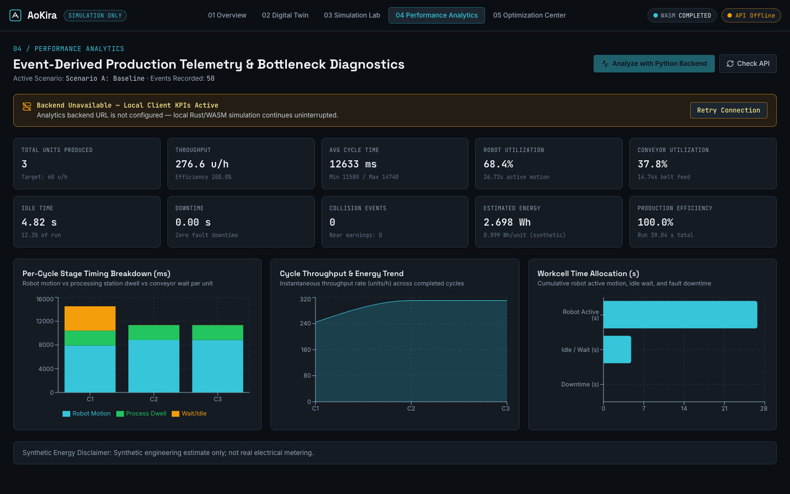 |
| **Online** (full stack): API Online | 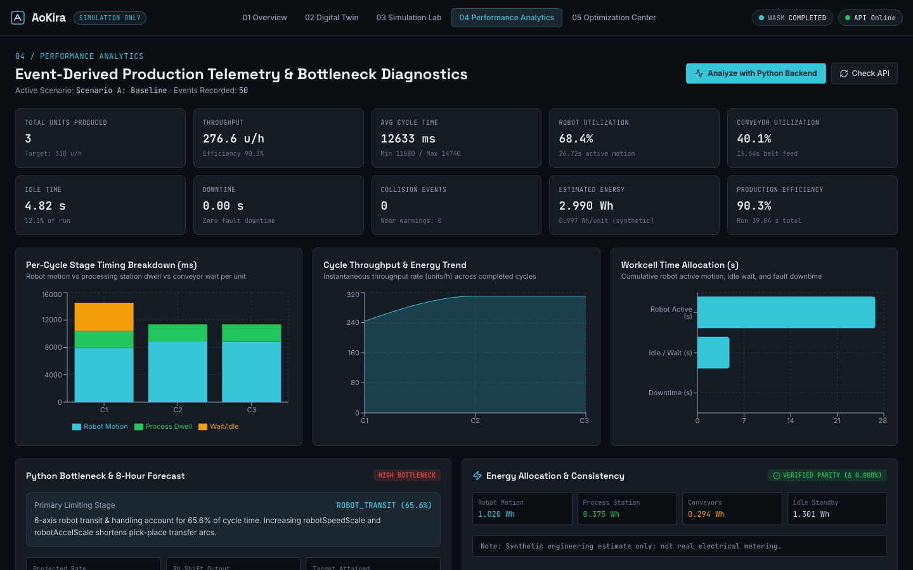 |

KPIs: total units, throughput (u/h), average/min/max cycle time, robot and conveyor utilization, idle time, downtime, collision events and near-miss warnings, estimated energy (Wh and Wh/unit), and production efficiency.
Charts: per-cycle stage timing breakdown, cycle throughput and energy trend, and workcell time allocation.

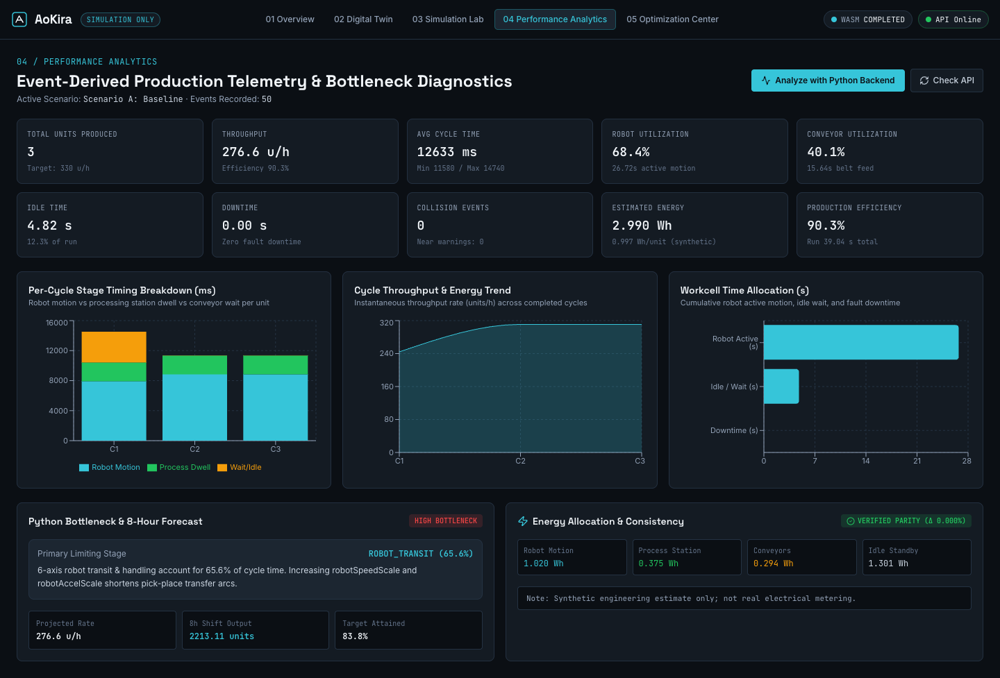
<sub>Full page after a 3-cycle Scenario A run with Python enrichment (full stack)</sub>

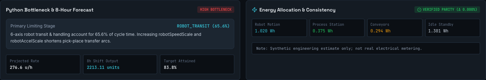
<sub>Python enrichment: primary limiting stage, projected rate, 8-hour shift output, energy allocation, and <code>VERIFIED PARITY</code> between browser and server KPIs (full stack)</sub>

---

### 05 · Optimization Center

Compare scenarios and search for better workcell parameters with SciPy SLSQP under a zero-collision constraint.

| Control | Options |
|---|---|
| **Base scenario** | Scenario A–D |
| **Objective function** | `Min Cycle` · `Min Energy` · `Balanced` |
| **Search bounds** | min/max for robot speed scale, robot accel scale, input belt, output belt, process dwell |
| **Constraints** | min throughput (units/h), optional max energy per unit (Wh). The zero-collision constraint is always enforced. |
| **Actions** | `Compare Scenarios (A–D)` · `Run Optimization` · `Load Base Preset Locally` · per-row `Load` · `Load into Simulation Lab` |

<table>
<tr>
<td width="50%">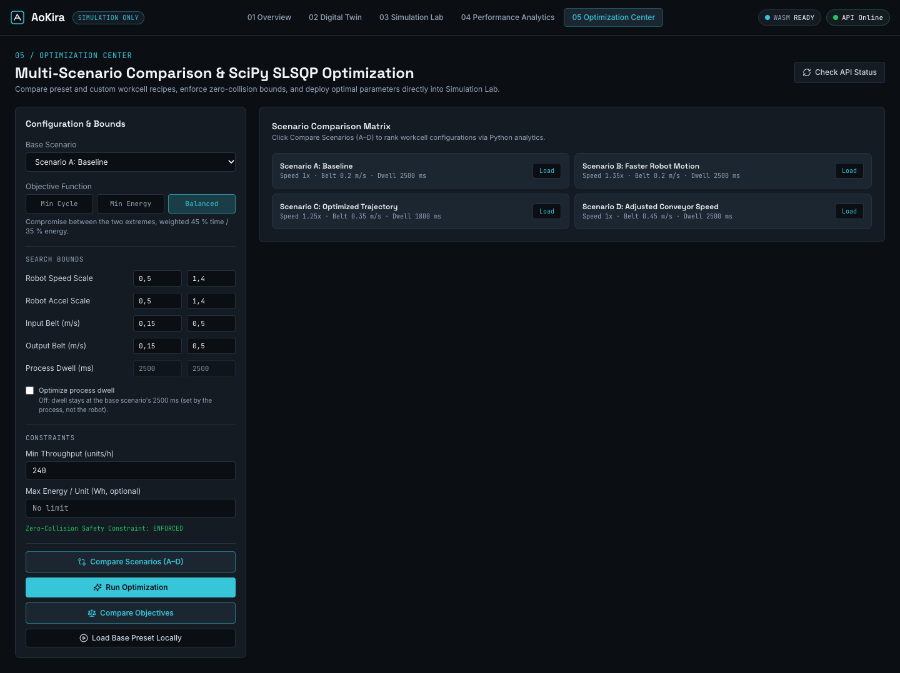<br><sub>Configuration and bounds, preset cards (full stack)</sub></td>
<td width="50%">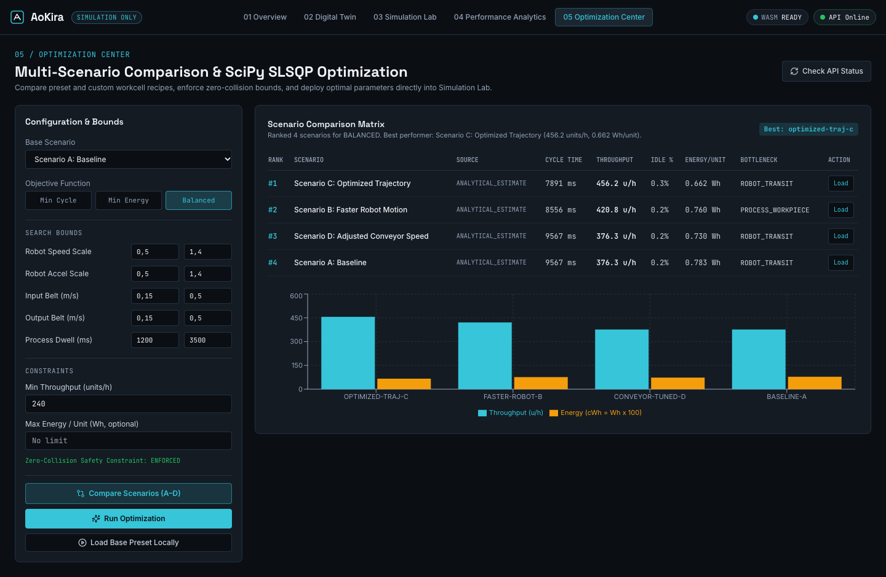<br><sub><b>Compare Scenarios</b>: ranked matrix + throughput/energy chart (full stack)</sub></td>
</tr>
</table>

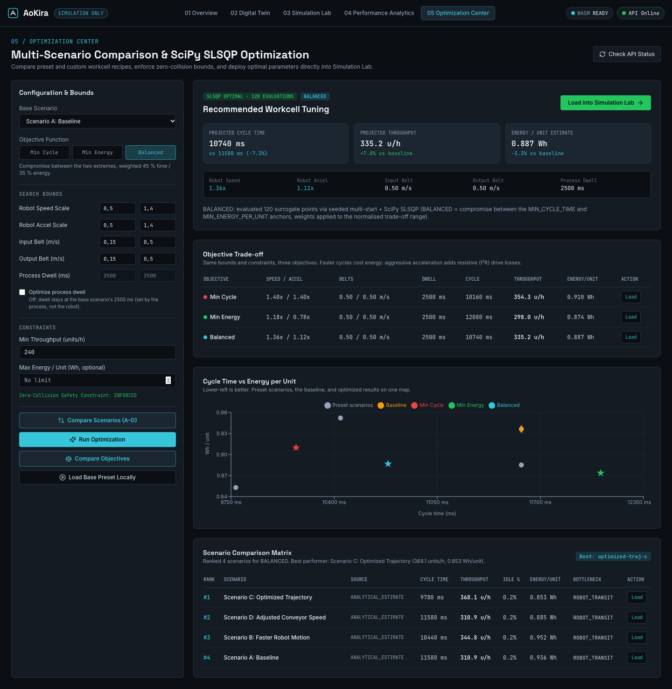
<sub><b>Run Optimization</b> (Balanced): recommended tuning with projected cycle time, throughput and energy per unit compared with the baseline (full stack)</sub>

<table>
<tr>
<td width="50%">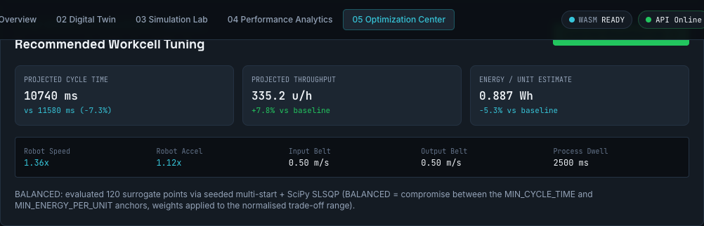<br><sub>Recommendation card with <code>Load into Simulation Lab</code></sub></td>
<td width="50%">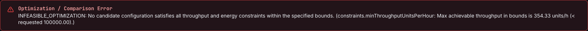<br><sub>Impossible constraint (min throughput 100,000 u/h) returns an <b>INFEASIBLE_OPTIMIZATION</b> diagnostic</sub></td>
</tr>
<tr>
<td width="50%">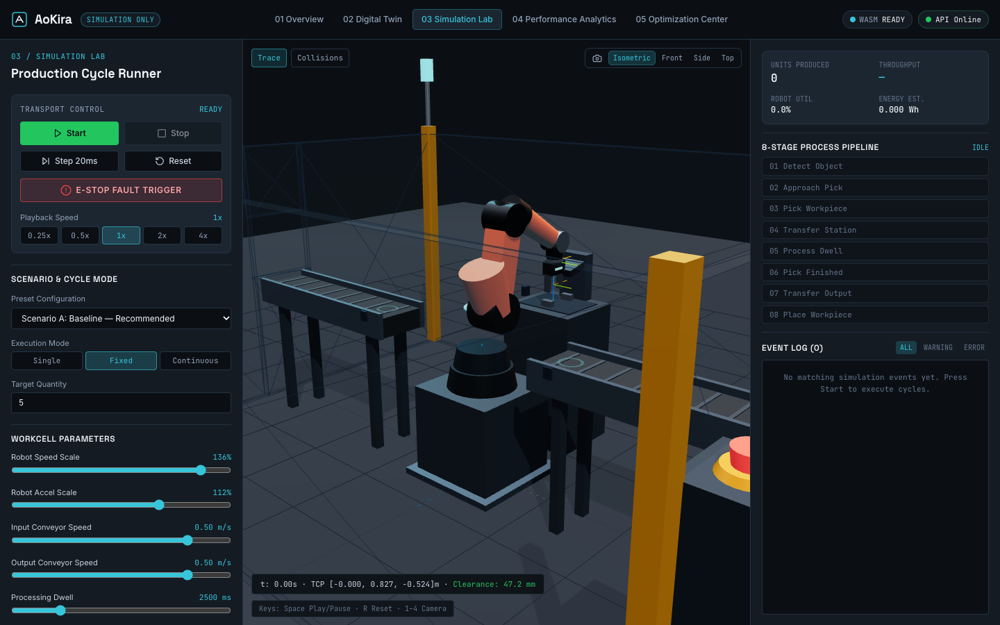<br><sub>Optimized parameters loaded into <b>Simulation Lab</b> as <code>*-optimized</code> (full stack)</sub></td>
<td width="50%">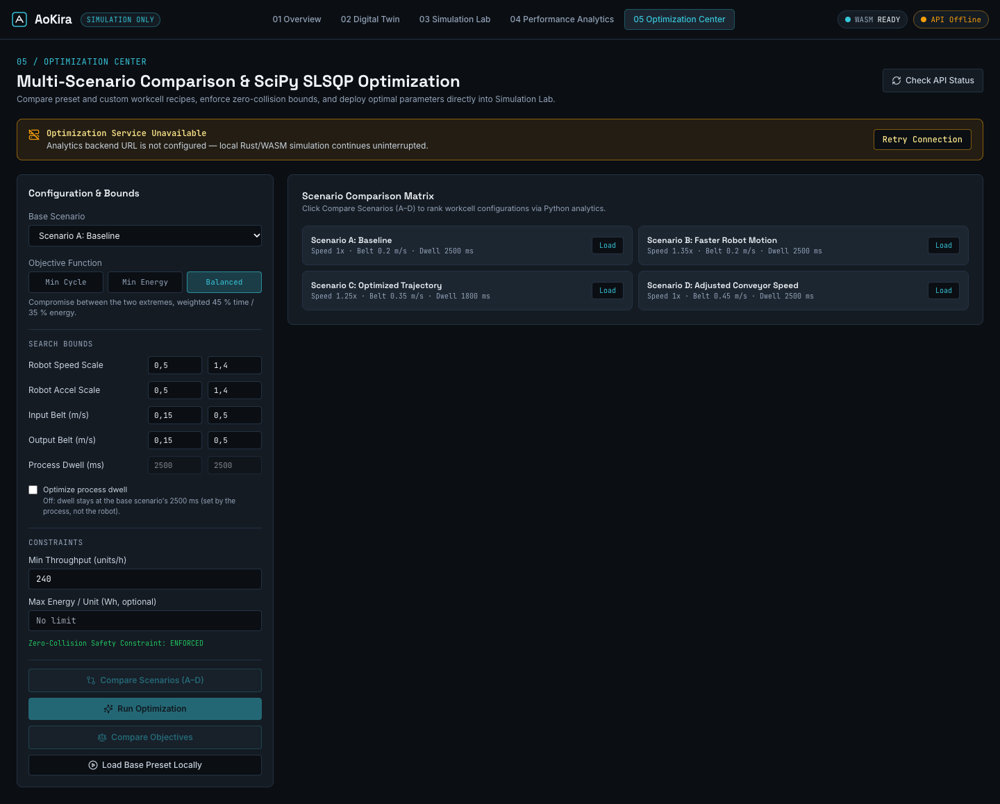<br><sub>On GitHub Pages, Python actions are disabled and a clear banner is shown (live)</sub></td>
</tr>
</table>

---

### Mobile layout

The layout is responsive down to 390 px. Navigation moves into a hamburger drawer, and the 3D viewport stacks above the panels.

<table>
<tr>
<td width="25%">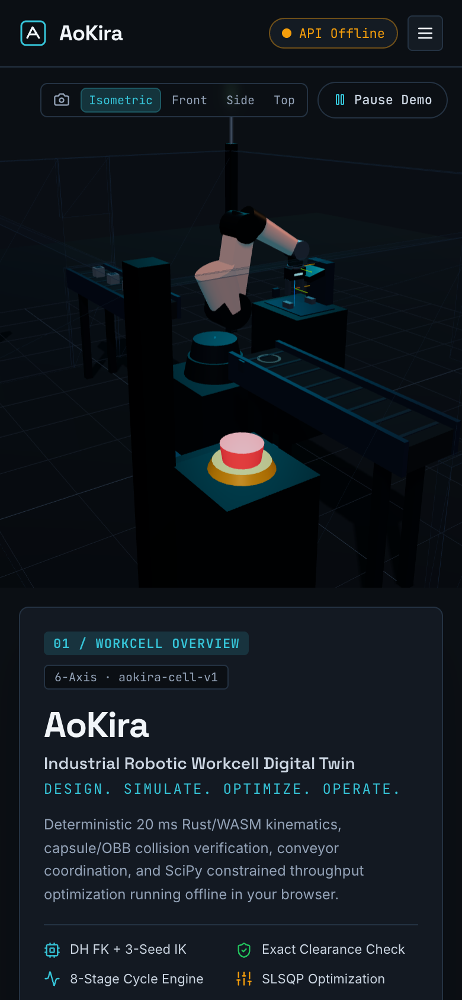<br><sub>Overview</sub></td>
<td width="25%">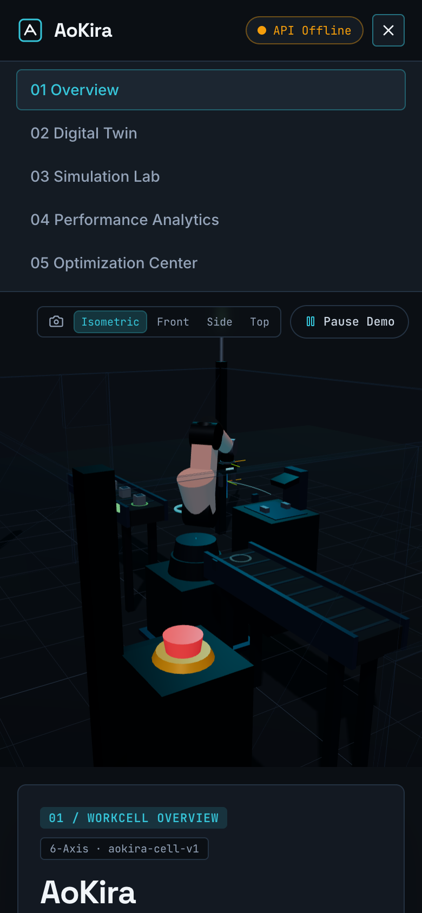<br><sub>Navigation drawer</sub></td>
<td width="25%">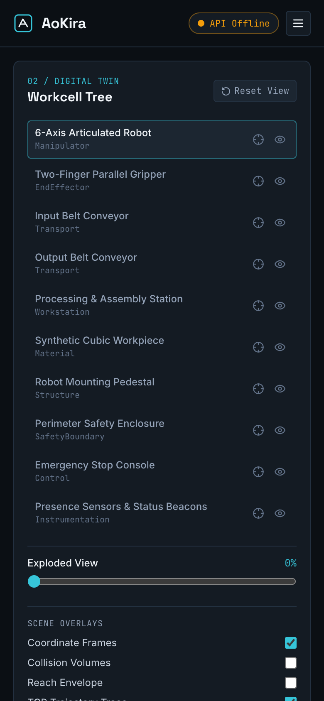<br><sub>Digital Twin</sub></td>
<td width="25%">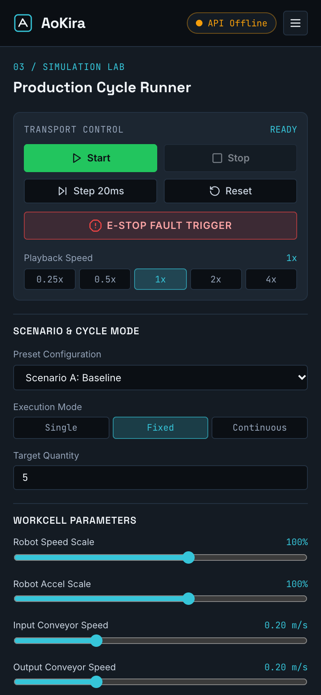<br><sub>Simulation Lab</sub></td>
</tr>
</table>

### REST API (Swagger)

The FastAPI service serves interactive OpenAPI docs at `/api/v1/docs`.

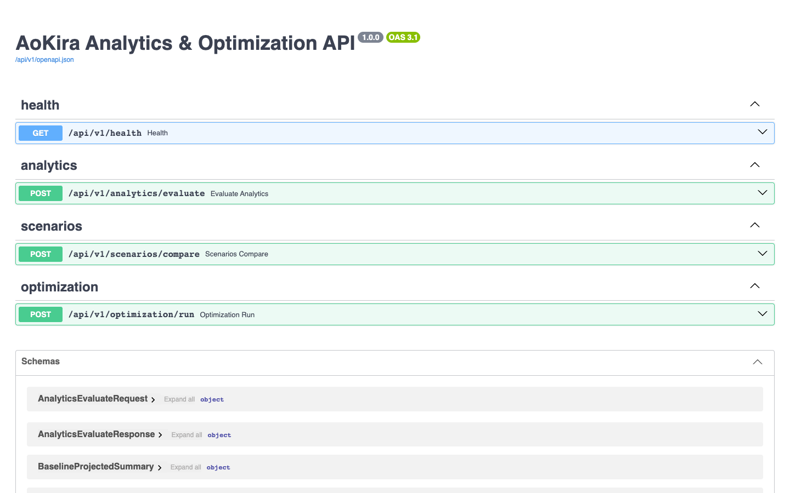

| Method | Endpoint | Purpose |
|---|---|---|
| `GET` | `/api/v1/health` | Service and contract version health check |
| `POST` | `/api/v1/analytics/evaluate` | Validate an event stream, recompute KPIs, bottleneck, energy breakdown, 8-hour forecast |
| `POST` | `/api/v1/scenarios/compare` | Rank scenarios A–D (or custom) by objective |
| `POST` | `/api/v1/optimization/run` | SciPy SLSQP + multi-start constrained parameter search |

Full request and response schemas and error codes (`VALIDATION_ERROR`, `INVALID_EVENT_SEQUENCE`, `INFEASIBLE_OPTIMIZATION`, `INTERNAL_ERROR`) are in [API_CONTRACT.md](API_CONTRACT.md).

---

## Scenario presets

Defined in [`data/scenarios/`](data/scenarios) and shared by the engine, the API and the UI.

| ID | Name | Robot speed | Robot accel | Input / output belt | Process dwell | Intent |
|---|---|---|---|---|---|---|
| `baseline-a` | Scenario A: Baseline | 1.00× | 1.00× | 0.20 / 0.20 m/s | 2500 ms | Canonical default parameters |
| `faster-robot-b` | Scenario B: Faster Robot Motion | 1.35× | 1.30× | 0.20 / 0.20 m/s | 2500 ms | Faster manipulator, same conveyors |
| `optimized-traj-c` | Scenario C: Optimized Trajectory | 1.25× | 1.15× | 0.35 / 0.35 m/s | 1800 ms | Smoother motion, faster feed, shorter dwell |
| `conveyor-tuned-d` | Scenario D: Adjusted Conveyor Speed | 1.00× | 1.00× | 0.45 / 0.45 m/s | 2500 ms | Faster belts to avoid starvation |

The single source of truth for geometry, DH parameters, joint limits and component metadata is [`data/workcell/aokira-workcell.v1.json`](data/workcell/aokira-workcell.v1.json).

---

## How it works

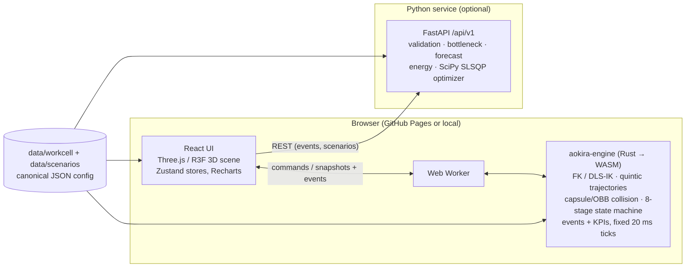

**Production cycle (8-stage state machine):**

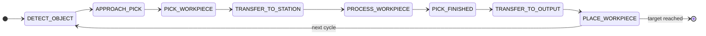

Key design points:

1. **Determinism.** The same workcell config and scenario (including seed) give the same event stream, timings and KPIs, whatever the display refresh rate. A committed golden fixture ([`data/fixtures/baseline-3cycles.golden.json`](data/fixtures/baseline-3cycles.golden.json)) guards this in CI.
2. **Off the UI thread.** The engine runs inside a dedicated Web Worker. Live snapshots are kept in refs outside React state, so the 3D scene renders at full frame rate.
3. **Graceful degradation.** API calls have strict timeouts (3 s / 10 s / 20 s). If the API fails, the UI shows explicit offline badges, and the simulation itself never stops.
4. **Contract parity.** TypeScript types and Pydantic v2 schemas mirror each other in camelCase. The API recomputes KPIs and reports the client/server difference (`< 0.01 %`).

Deep dives: [SIMULATION_SPEC.md](SIMULATION_SPEC.md) (frames, DH table, IK, trajectories, collision, state machine, energy model) and [ARCHITECTURE.md](ARCHITECTURE.md).

---

## Tech stack

| Layer | Technologies |
|---|---|
| **Frontend** | TypeScript (strict), React 18, Vite, Three.js, `@react-three/fiber`, `@react-three/drei`, Zustand, Tailwind CSS, Recharts, lucide-react |
| **Simulation core** | Rust, `wasm-bindgen`, `serde`, `wasm-pack`, Web Workers |
| **Analytics and optimization** | Python 3.12, FastAPI, Pydantic v2, NumPy, SciPy (SLSQP), Uvicorn |
| **Testing** | `cargo test` + clippy + rustfmt, pytest + ruff, Vitest + Testing Library, Playwright (Chrome WebGL) |
| **Delivery** | GitHub Actions → GitHub Pages (frontend + WASM), Docker image for the API |

---

## Repository structure

```text
AoKira/
├── .github/workflows/ci-deploy.yml  # Rust/WASM · Python + Docker smoke · Web + E2E · Pages deploy
├── apps/
│   ├── web/                         # React + R3F frontend, Web Worker bridge
│   │   ├── src/features/            # overview · digital-twin · simulation · analytics · optimization
│   │   ├── src/components/scene/    # 3D workcell models, camera rig, environment
│   │   ├── src/workers/             # simulation.worker.ts (wraps the WASM engine)
│   │   ├── e2e/                     # Playwright E2E-01..05
│   │   └── screenshots/             # Playwright README screenshot capture
│   └── api/                         # FastAPI analytics & SciPy optimization + Dockerfile
├── crates/aokira-engine/            # Rust → WASM simulation core (+ perf_bench example)
├── data/
│   ├── workcell/                    # aokira-workcell.v1.json (single source of truth)
│   ├── scenarios/                   # Scenario A–D presets
│   └── fixtures/                    # Golden deterministic regression fixture
├── docs/screenshots/                # Images used in this README
├── scripts/
│   ├── build-wasm.sh                # Builds WASM into apps/web/src/wasm
│   └── test-all.sh                  # Unified Rust + Python + Web verification
└── *.md                             # PRD, architecture, specs, contracts, design, test plan
```

---

## Getting started

### Prerequisites

- **Node.js ≥ 20** and npm
- **Rust** stable + `wasm-pack` (`rustup target add wasm32-unknown-unknown`)
- **Python ≥ 3.12**
- **Google Chrome** (for Playwright E2E and screenshots)
- Docker (optional)

### 1 · Build the WASM engine

```bash
./scripts/build-wasm.sh
```

### 2 · Run the Python API (optional, enables Python features)

```bash
cd apps/api
python3 -m venv .venv && source .venv/bin/activate
pip install -e ".[dev]"
uvicorn app.main:app --reload --port 8000
```

Or with Docker:

```bash
docker build -t aokira-api apps/api && docker run -p 8000:8000 aokira-api
```

### 3 · Run the web app

```bash
cd apps/web
npm install
VITE_API_BASE_URL=http://127.0.0.1:8000 npm run dev
```

Open http://localhost:5173. If you leave out `VITE_API_BASE_URL`, the app runs in browser-only mode, exactly like the GitHub Pages build.

### Environment variables

| Variable | Where | Purpose |
|---|---|---|
| `VITE_API_BASE_URL` | web build | FastAPI base URL. If unset, the app runs offline (WASM only). |
| `VITE_BASE_PATH` | web build | Public base path (`/AoKira/` for GitHub Pages) |
| `AOKIRA_CORS_ORIGINS` | API | Comma-separated allowed origins (default: localhost dev/preview + `https://orls967.github.io`) |

To connect the hosted Pages build to a deployed API, set the repository variable **`VITE_API_BASE_URL`** (*Settings → Secrets and variables → Actions → Variables*) and re-run the workflow.

---

## Testing & CI/CD

```bash
./scripts/test-all.sh          # Rust fmt + clippy + tests, Python ruff + pytest, Web typecheck + Vitest + build
```

Run the steps one at a time:

```bash
cd crates/aokira-engine
cargo fmt --check && cargo clippy --all-targets -- -D warnings && cargo test
cargo run --release --example perf_bench
```

```bash
cd apps/api && ruff check . && pytest
```

```bash
cd apps/web && npm run typecheck && npm run test && npm run test:e2e   # E2E needs API on :8000 + `npm run preview`
```

| Suite | Coverage |
|---|---|
| **Rust** (22 tests) | FK home and extremal poses, IK round-trip and unreachable cases, quintic velocity/acceleration limits, collision primitives and near-miss, production state machine, golden fixture regression |
| **Python** (8 tests) | Smoke + API contract `API-01..07`: health & CORS, evaluate (golden-fixture parity), invalid-input rejection, scenario ranking, optimization within bounds, infeasible domain error, statelessness/determinism |
| **Web** (13 tests) | `FE-01..05`: Simulation Lab transport/fault, Digital Twin tree & selection, Analytics empty + offline, Optimization compare/run/infeasible, reduced-motion & WebGL 2D fallback, routing & config loading |
| **E2E** (5 tests) | `E2E-01..05` in real Chrome + WebGL against Uvicorn: overview, twin, full cycle → analytics, optimization + offline, mobile 390×844 |

**GitHub Actions** ([`ci-deploy.yml`](.github/workflows/ci-deploy.yml)) runs on every push and PR to `main`: `rust-and-wasm` → `python-api` (including the Docker health smoke test) → `web-and-e2e` (including Playwright and the `/AoKira/` Pages bundle with a `404.html` SPA fallback) → `deploy-pages` (on `main` only).

### Regenerating screenshots

```bash
cd apps/web
# Live GitHub Pages (browser-only views, mobile)
SHOTS_TARGET=pages SHOTS_BASE_URL=https://orls967.github.io/AoKira/ npm run screenshots
# Local full stack (API running on :8000, build served on :4174)
SHOTS_TARGET=api SHOTS_BASE_URL=http://127.0.0.1:4174/ npm run screenshots
```

Images are written to `docs/screenshots/`.

---

## Measured performance

Measured on a local Apple Silicon machine (Phase 7 baseline):

| Metric | Result |
|---|---|
| Rust: 1,000 simulation ticks (`perf_bench --release`) | `22.9 ms` total (`0.023 ms/tick`) |
| Rust: 3-seed DLS IK, reachable | `0.0133 ms` avg / `0.0148 ms` worst |
| Rust: IK unreachable rejection | `0.0013 ms` |
| FastAPI `POST /analytics/evaluate`, 1,000 events | `22.6 ms` |
| FastAPI `POST /optimization/run`, SLSQP | `7.8 ms` |
| WebGL canvas frame rate (`E2E-01`) | `~60 FPS` |
| WASM binary (`aokira_engine_bg.wasm`) | `270 kB` raw / `109 kB` gzip |

---

## Documentation index

| Document | Covers |
|---|---|
| [PRD.md](PRD.md) | Vision, personas, user journeys, scope, exclusions, acceptance criteria `AC-01`–`AC-18` |
| [DATA_MODEL.md](DATA_MODEL.md) | Canonical entities, units, events, metrics, ownership |
| [SIMULATION_SPEC.md](SIMULATION_SPEC.md) | Frames, DH/FK/IK, quintic planning, collision, state machine, energy |
| [ARCHITECTURE.md](ARCHITECTURE.md) | 3-tier topology, worker protocol, module layout, deployment |
| [API_CONTRACT.md](API_CONTRACT.md) | `/api/v1` endpoints, schemas, error envelopes, offline rules |
| [DESIGN.md](DESIGN.md) | Visual tokens, typography, page layouts, accessibility, reduced motion, WebGL fallback |
| [TEST_PLAN.md](TEST_PLAN.md) | Test suites, baseline protocol, AC verification matrix |
| [flow.md](flow.md) | Phases 0–8 roadmap and validation gates |
| [constraints.md](constraints.md) | Engineering invariants and guardrails |
| [IMPLEMENTATION_PROGRESS.md](IMPLEMENTATION_PROGRESS.md) | Phase-by-phase delivery log and technical decisions |

---

## Known limitations

1. **Synthetic physics and energy.** Conveyor transport, rigid grasp attachment, capsule/box collision and power estimates are simplified demonstrator models. They are not rigid-body physics, mesh-exact contact or calibrated metering.
2. **The hosted demo has no backend.** GitHub Pages serves static files only, so Python enrichment and optimization need a locally running (or separately deployed) API.
3. **Optimizer objectives converge with default bounds.** With the default search bounds, `Min Cycle`, `Min Energy` and `Balanced` all recommend the same corner of the space (max speed and acceleration, fastest belts, shortest dwell). This is because the synthetic idle-standby power dominates energy per unit, so finishing faster is also cheaper. Tighter bounds or an energy cap make the objectives separate.
4. **Stateless API.** There are no user accounts, persistence or multi-user collaboration.
5. **Locale-formatted inputs.** Numeric inputs follow the browser locale (for example `0,5` instead of `0.5`).

---

<div align="center">
<sub>AoKira: a simulation-only engineering demonstrator. Not for controlling real equipment.</sub>
</div>
